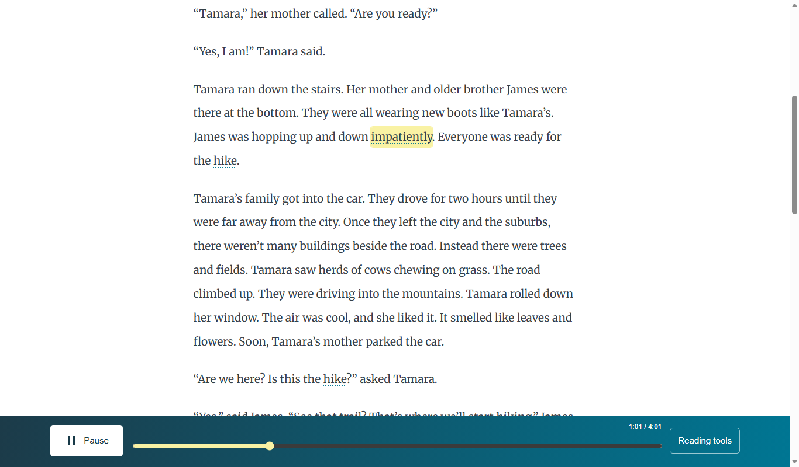

# Sound Along spec

*A read-along for ReadWorks: how it works, what is built, and what is still open.*

First-pass spec, written with AI and checked against the code at commit 33e2648. Not yet reviewed by a person.

ReadWorks' brief says it gives teachers 6,893 free reading passages, all with audio. About 64% of them use a computer voice that ReadWorks describes as unnatural, and a student who loses their place can't see which word is being said or easily go back to it. Sound Along is a read-along built for that problem: a natural voice, each word lit as it is spoken, and a tap on any word to hear the passage from there.

A cloud workflow takes a passage's text and makes the audio and a time for each word. The reader in the browser uses those times to light the words. Around that sit help with hard words, a larger view for younger readers, a way to record volunteers, and made-up demos of what a teacher could see.

**Go straight to:** [see the reader](focused-mode.md) · [what's proven](what-is-proven-and-what-is-not.md) · [deploy and test](deploy-and-smoke-test.md)

**The essential link is a word number shared by the page, its timing row, and the sound.**

## Where it stands

This spec describes one version of the code: commit `33e2648` of the team repository. The team reports it is deployed on the event's AWS account with the Ruth voice. The live site lists 14 passages, and its reader passed 42 of 42 browser checks with the sound off. Nobody has judged the audio by ear, and no child, teacher or ReadWorks staff member has tried this version. [What is proven and what is not](what-is-proven-and-what-is-not.md) goes through it part by part.

## Where to start

- **ReadWorks content and program staff:** [What ReadWorks asked for](what-readworks-asked-for.md), then [ReadWorks' feedback and our answers](readworks-feedback-and-our-answers.md) and [Open questions for ReadWorks](open-questions-for-readworks.md).
- **Engineers taking this over:** [Repo map](repo-map.md), [Data flow](data-flow.md), [AWS stack and settings](aws-stack-and-settings.md), then [Deploy and smoke test](deploy-and-smoke-test.md).
- **Anyone with five minutes:** [Sound Along in one picture](sound-along-in-one-picture.md), then [Focused mode](focused-mode.md).

Every page starts with the idea in plain words, then a picture where one helps. The technical details are at the bottom.

## All 51 pages

## The product at a glance

- [Sound Along in one picture](sound-along-in-one-picture.md): How does a ReadWorks passage become a read-along? (built and tested locally)
- [What ReadWorks asked for](what-readworks-asked-for.md): What student problem is Sound Along meant to solve? (external)
- [ReadWorks' technical expectations](readworks-technical-expectations.md): What technical shape did ReadWorks ask the team to fit? (external)
- [ReadWorks' feedback and our answers](readworks-feedback-and-our-answers.md): What changed in response to each item ReadWorks raised? (built and tested locally)
- [What published, checked, and draft mean](what-published-checked-and-draft-mean.md): Does a visible passage or approval label mean a person heard and approved it? (built and tested locally)
- [What is proven and what is not](what-is-proven-and-what-is-not.md): Which claims have evidence at their actual size? (built and tested locally)
- [Open questions for ReadWorks](open-questions-for-readworks.md): Which product and operating decisions belong to ReadWorks? (external)
- [After the hackathon](after-the-hackathon.md): What later work do the design documents propose? (design only, not built)

## The reader

- [Focused mode](focused-mode.md): What does a reader see first, and how do they reach the other features? (built and tested locally)
- [The passage reader](the-passage-reader.md): What can a reader do on the passage screen? (built and tested locally)
- [Follow-along choices](follow-along-choices.md): How can a reader choose what the narration marks? (built and tested locally)
- [Speed slider](speed-slider.md): How can a reader change the narration pace? (built and tested locally)
- [Younger readers view](younger-readers-view.md): What changes when a reader opens the younger-readers link? (built and tested locally)
- [Story library](story-library.md): How does a reader find and open a passage? (built and tested locally)
- [Screen sizes and accessibility](screen-sizes-and-accessibility.md): What has been checked about the reader across screens and input methods? (built and tested locally)
- [All features and themes](all-features-and-themes.md): What is behind the All features switch, and why is it there? (built and tested locally)
- [The reader engine](the-reader-engine.md): How does narration stay connected to words on the page? (built and tested locally)

## Word help and the classroom

- [Word meanings](word-meanings.md): How does a reader get help with a word in the passage? (built and tested locally)
- [Words to know](words-to-know.md): Where can a reader see a passage's vocabulary in one place? (built and tested locally)
- [Hear words in parts or slowly](syllable-guides-and-slow.md): How can a reader hear a word in parts or more slowly? (built and tested locally)
- [Reviewing word help](reviewing-word-help.md): How does a person check generated meanings, guides, and clips before trusting them? (built and tested locally)
- [Usage counts](usage-counts.md): What reading activity does this prototype count, and where does it go? (built and tested locally)
- [Teacher dashboard](teacher-dashboard.md): What can a teacher see about one class assignment? (built and tested locally)
- [Teacher demo](teacher-demo.md): What classroom experience does the demo actually show? (demo with made-up data)
- [Class link flow](class-link-flow.md): How does a teacher link become a student report in this prototype? (built and tested locally)

## Making the audio

- [Passage intake](passage-intake.md): How does a passage enter audio generation? (built and tested locally)
- [Narration voice](narration-voice.md): What voice reads the passage, and how is it chosen? (built and tested locally)
- [Generative voice setting](generative-voice-setting.md): What changes when the generative voice is enabled? (built, off by default)
- [Word timing](word-timing.md): How does each written word get a playback time? (built and tested locally)
- [Audio and pace checks](audio-and-pace-checks.md): What does the pipeline check before accepting a recording? (built and tested locally)
- [Heard versus written check](heard-versus-written-check.md): Can a suspected difference between the audio and passage stop publication? (built, off by default)
- [Publish to reader](publish-to-reader.md): How does checked audio become a voice in the reader? (built and tested locally)
- [Send a passage API](send-a-passage-api.md): How can another system submit a passage and check its result? (built, off by default)
- [AWS stack and settings](aws-stack-and-settings.md): What cloud pieces and switches make up the audio pipeline? (built and tested locally)
- [Deploy and smoke test](deploy-and-smoke-test.md): How would a teammate deploy this stack and check one passage end to end? (built and tested locally)
- [Cost of a passage](cost-of-a-passage.md): What does one new narrated passage cost to generate? (built and tested locally)

## The data

- [Data flow](data-flow.md): Where does one passage and its audio go before a student taps a word? (built and tested locally)
- [The passage file](the-passage-file.md): What does a passage source file contain, and who uses it? (built and tested locally)
- [Reader passage record](reader-passage-record.md): What information does the reader load for one passage? (built and tested locally)
- [Word numbers and timing rows](word-numbers-and-timing-rows.md): How does a written word point to its moment in audio? (built and tested locally)
- [Library index](library-index.md): What list tells the website which stories are available? (built and tested locally)
- [Manifest and job record](manifest-and-job-record.md): Where do generation results and review state live? (built and tested locally)
- [Website files and media](website-files-and-media.md): Which files make up the website, and where is generated media kept? (built and tested locally)

## Tools for people

- [Volunteer recorder](volunteer-recorder.md): How can a volunteer make a reading for a person to review? (built and tested locally)
- [Human recordings](human-recordings.md): How does an approved volunteer reading become a reader voice? (built and tested locally)
- [Holds lab](holds-lab.md): How can the team compare policies for uncertain audio without changing publication? (built and tested locally)
- [Held recordings](held-recordings.md): What would a reviewer see when a take is held for uncertain words? (built, off by default)
- [Names and pronunciation](names-and-pronunciation.md): Can the system tell whether a person's name is pronounced correctly? (design only, not built)
- [Tests and how to run them](tests-and-how-to-run-them.md): Which checks exist, how do I run each, and what does each need? (built and tested locally)
- [Repo map](repo-map.md): Where is each part of Sound Along in this repository? (built and tested locally)
- [Building the reader](building-the-reader.md): How does the editable reader source become the static website? (built and tested locally)
