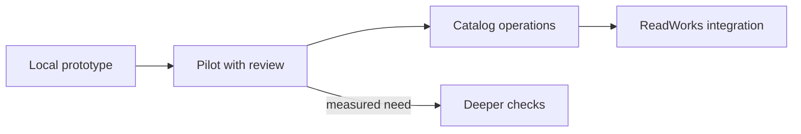

# After the hackathon

*What later work do the design documents propose?*

The product at a glance · Status: design only, not built

ReadWorks' small content team would need more than a one-passage demo to run Sound Along across a growing library. The two supplied design documents sketch later phases: a stronger check of what the audio says, a way for editors to resolve held takes, a controlled route for volunteer recordings, and classroom settings and reporting tied to real ReadWorks accounts. These are proposals, not commitments, and none is built.

The validation design's pilot path, called "Balanced," transcribes every generated passage with speech recognition and compares it with the text. It measures timing against hand-marked examples and sends uncertain takes to a person. More expensive checks come only when measured error rates justify them. The teacher design calls for server-held settings, content approvals, and eventually ReadWorks sign-in and assignments. Its hackathon-phase targets are only demonstrated here with made-up people. A pilot with ReadWorks, counting staff time and privacy review, should set the schedule, not the design document.

**Every item below is an idea, not built as the proposed production system.**

The picture shows the order of phases. Deeper checks branch off only when the pilot shows a need.

## How it connects

[What is proven and what is not](what-is-proven-and-what-is-not.md) shows the starting evidence. [Open questions for ReadWorks](open-questions-for-readworks.md) lists decisions that should shape any pilot. For the smaller optional check already in code, see [heard versus written check](heard-versus-written-check.md).

## Where it stands

These phases have not run on the event AWS account or with real classrooms. The current optional quality gate and teacher demo are partial local prototypes, not the Balanced pipeline or a production assignment service. No real device, content-team pilot, volunteer consent flow, or student outcome study is recorded. Ruth was heard in an earlier separate-account trial, which does not validate the later system.

---

## Technical details

| Proposed phase | Idea, not built | Decision or proof needed |
|---|---|---|
| Pilot audio validation (The team's validation design document) | Transcribe and classify every generated passage; retry a suspect take once; use agreed end times; maintain names and vocabulary as editable data; human review queue for holds and samples; hand-marked timing set in continuous tests. | Measure false holds and audible errors, agree timing tolerance and reviewer capacity. Current `qualityGate` is optional, off by default, and narrower. |
| Volunteer track (The team's validation design document) | Upload with consent, instant audio feedback, transcript alignment, sentence repair, trust tiers, and versioned publication. | Confirm whether ReadWorks wants volunteers, rights and withdrawal rules, and who approves takes. The repository's local recorder is a tool, not this AWS route. |
| Catalog operations (The team's validation design document) | Bounded parallel generation, quotas, cost monitoring, and a content queue. | Test service quotas and price in `us-west-2`, plus staff time per passage. No catalog run is recorded. |
| Deeper checks on trigger (The team's validation design document) | Additional pronunciation analysis, a second timing aligner, browser sync checks, and managed review workforce only when pilot metrics justify each. | Define triggers from actual errors; the document's thresholds are proposals. |
| Classroom phase 2 (The team's teacher design document) | Content-team sign-in, server-side word-help approval, co-teacher access, and an event pipeline. | ReadWorks' privacy, identity, and authorization decisions. Existing `frontend-src/src/teacherDemo/` uses made-up data and browser memory. |
| ReadWorks integration phase 3 (The team's teacher design document) | Use ReadWorks' real accounts and assignment system; consider a school admin role only if asked. | Agree API, document format, UX, ownership, and data-retention contract. |

The design documents contain schedules and cost estimates, not measurements from this branch. Recheck any plan with `npm run build`, `npm run test:frontend`, `python tests/test_quality_gate.py`, and a pilot run in the target account before treating it as implemented.

---

Previous: [Open questions for ReadWorks](open-questions-for-readworks.md) · [Spec home](README.md) · Next: [Focused mode](focused-mode.md)
