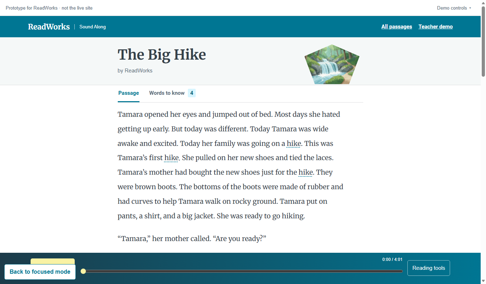

# All features and themes

*What is behind the All features switch, and why is it there?*

The reader · Status: built and tested locally

The first screen is kept simple on purpose. **All features** opens the wider set of designs and tools so teammates and ReadWorks can compare options without changing the story.

A theme bar, collapsed under a **Demo controls** menu, changes the look of the library, reader, or kid view. The reader also gains highlight colors, a voice visualization, line-focused treatments, and a sound switch. The library gains a bookshelf layout and a picture of where the narration pauses.

These options add choices before a reader has begun, so they sit behind the button. **Back to focused mode** returns to the simple view, and the browser remembers the choice. ReadWorks saw an earlier themed demo. Focused mode came later and has not had that review.

**All features is the comparison space for the prototype's extra designs and tools.**

The screenshot shows the collapsed Demo controls strip at the top and the Back to focused mode button, which here overlaps the player.

Opening Demo controls reveals the comparison choices behind All features:

## How it connects

[Focused mode](focused-mode.md) explains the starting view. [The passage reader](the-passage-reader.md) covers the reader both views share, and [Younger readers view](younger-readers-view.md) shows how one link changes with the switch.

## Where it stands

The build team's Nov. 4 focused run passed 41 of 41 checks, including switching to All features and back. The classic reader run passed 162 of 162. Both ran muted. The team reports the site with the switch and themes is deployed on the event AWS account with Ruth, but did not verify every theme there. Neither has been tried on a real device, and no child or teacher has tried them. ReadWorks reviewed only the earlier themed demo.

---

## Technical details

`frontend-src/src/focused.js` saves the mode under `rwp-focused-mode`. `frontend-src/src/App.vue` renders `ThemeBar.vue` and the return button when focused mode is off, subject to route and sample guards. `frontend-src/src/themes.js` lists Signature, ReadWorks, Crisp, Bright, Storybook, Soundwave, and Classic themes. `frontend-src/src/looks/index.js` lazily selects the corresponding library, passage, or kid component. `ThemeBar.vue` attempts to carry the audio time and playing state when a viewer changes themes on a passage screen; this is a prototype convenience, not a verified cross-theme listening guarantee.

In `MixReader.vue`, `!focused` exposes extra controls. In `MixLibrary.vue`, it exposes the bookshelf layout and voice maps. The same `#/look/mix/kid/<uuid>` route displays the article-shaped `MixReader` in focused mode and `MixKid` in All features. The switch therefore changes more than decorative styling.

Check the switch locally with `node frontend-src/tests/focused_browser.mjs http://127.0.0.1:8992` after starting Vite at that URL. Review each theme on real devices and with actual audio before deciding which ideas belong in a ReadWorks product.

---

Previous: [Screen sizes and accessibility](screen-sizes-and-accessibility.md) · [Spec home](README.md) · Next: [The reader engine](the-reader-engine.md)
