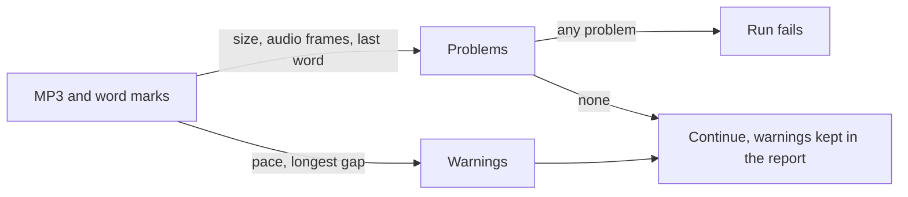

# Audio and pace checks

*What does the pipeline check before accepting a recording?*

Making the audio · Status: built and tested locally

A recording can exist and still be too short or oddly paced for a reader. Before a passage is made available, Sound Along checks the basics. The MP3 must have real content and readable audio. Word markers must exist. The last marked word must not fall far past the end of the audio. The check also records the speaking pace and the longest gap between word starts.

Some findings stop the run. Others are warnings for a person to look at. A pace outside the expected range is a warning, which helps spot an odd take without rejecting every slow sentence.

These checks cannot hear. They do not catch a mispronounced name, confirm that every word was spoken, or judge whether the voice sounds pleasant.

**Passing these checks shows the file and timing are well formed; a person still has to listen.**

Problems stop the run, while warnings travel with the passage:

## How it connects

[Heard versus written check](heard-versus-written-check.md) adds an optional word-by-word comparison. [Word timing](word-timing.md) explains what the marks mean, and [Publish to reader](publish-to-reader.md) describes the gate that follows.

## Where it stands

The checks are implemented and locally testable. No current run on the event AWS account was confirmed. A local version of the word comparison would hold both long passages timed against existing ReadWorks audio, partly because recognition errs. That audio is not in the repo, and no result from a person listening to this stack is either. No target-device trial with sound and a reader was confirmed.

---

## Technical details

`lambdas/worker/handler.py` `validate_outputs` reads the Polly MP3 and marks. It fails on audio under 1,000 bytes, unreadable MP3 frames, no word marks, or a last word start more than 0.5 seconds beyond audio duration. `lambdas/worker/audio_check.py` walks MPEG frames for duration, computes words per minute from whitespace-separated normalized text, and finds the largest gap between word starts. A gap over 1.5 seconds or pace outside 90–200 words per minute becomes a `qc.warnings` entry, not `qc.problems`. The default manifest stores `qc`; the optional quality-gate manifest writer omits `qc`, though the in-flight event still has it. Validation does not itself require 100% mark coverage; the enabled reader bridge has stricter per-word mapping later.

`EmitMetrics` emits duration, pace, warning count, characters, bytes, marks, completion, and estimated Polly cost to CloudWatch after reader publication, except when cached audio is reused. Run `python tests/test_audio_check.py` for local module checks. The design validation document proposes broader checks such as hand-marked timing and a review queue; those are ideas, not built into this path.

---

Previous: [Word timing](word-timing.md) · [Spec home](README.md) · Next: [Heard versus written check](heard-versus-written-check.md)
