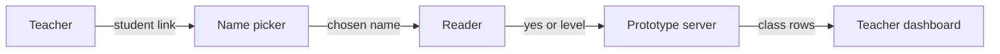

# Class link flow

*How does a teacher link become a student report in this prototype?*

Word help and the classroom · Status: built and tested locally

A teacher who wants to see who opened an assignment needs a way to tie a report to a student. A teacher can make a passage link with sound, voice, and reader-view choices. When the shared prototype server is configured, the teacher can also add a made-up class list. The student link then asks "Who's reading?" The reader picks a name or says they are not on the list. Only events after a name is chosen, for that assigned passage, are reported. The teacher gets a separate class-progress link that shows a yes or a playback level under each name, with finer detail only when pooled. The no-name choice sends no progress.

The big limit is identity. Nothing checks who a student is. Anyone with the student link can see the roster and pick any name, by mistake or on purpose, so a row can be false. The teacher link uses a secret key, but forwarding it would also expose the dashboard. ReadWorks and its counsel decide whether this named flow is appropriate and what sign-in, access, and retention rules it needs before real use.

**The link can demonstrate class reporting; it cannot verify a child's identity.**

## How it connects

[Usage counts](usage-counts.md) defines the reported fields. [Teacher dashboard](teacher-dashboard.md) shows the resulting rows. [Teacher demo](teacher-demo.md) is the separate presentation built from fixed data.

## Where it stands

The student link opens the classic reader, not the focused reader, which records no events. The flow is implemented against a configured server. The server side is not in this repo; only its written contract is, so what answers those requests couldn't be confirmed. The repo's data sheet describes a local end-to-end check with made-up students and a local server, which is not evidence of operation on the event AWS account. No real student, teacher, or ReadWorks person has used it, and no real device trial or human listening check could be confirmed. The build team's browser checks used muted sound.

---

## Technical details

`frontend-src/src/views/Teacher.vue` builds the reader URL (`#/p/` for the classic reader or `#/kid/` for the younger view). With `VITE_API_BASE` configured, `POST /api/assignments` saves passage settings plus optional names; the returned assignment ID is appended as `&a=<id>` to the student link's hash, and the teacher gets `#/teacher/class/<id>?k=<teacherKey>`. With no configured API, the page attempts a local assignment server but does not create the roster-reporting link. A failed save still leaves an ordinary reader link, with a failure message.

`frontend-src/src/dataKit/classroom/classLink.js` reads `a`, fetches the roster, and keeps a chosen `{ assignmentId, passageId, key, name }` in session storage. `StudentPick.vue` shows every name and an “I'm not on this list” path that disables reporting. `notMe()` clears the choice. `dataKit/report.js` listens to new events and sends only allowed yes or level fields for the assigned passage through `POST /api/progress`; it does not send the device's old totals. `TeacherClass.vue` posts the teacher key to `/api/class-progress` and renders the result alphabetically.

`frontend-src/src/dataKit/data_sheet.html` says the local test server accepts only listed fields and sets records to expire after 14 days. The identity gap remains even with that field filter: a visitor can select another name or send allowed values under that student's key. Real sign-in and access control are ideas, not built. Test the client path with `cd frontend-src; node src/dataKit/usage.test.mjs` and a local API-backed class-link session. The event AWS path could not be confirmed.

---

Previous: [Teacher demo](teacher-demo.md) · [Spec home](README.md) · Next: [Passage intake](passage-intake.md)
