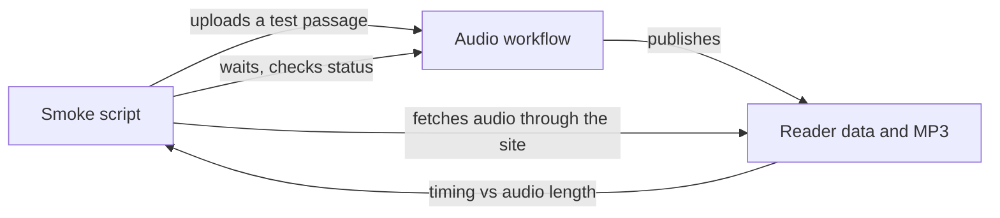

# Deploy and smoke test

*How would a teammate deploy this stack and check one passage end to end?*

Making the audio · Status: built and tested locally

Deploying puts the audio workers and the reader website into one cloud environment. A teammate then publishes the website and submits a small passage. The upload starts a generation run by itself. The smoke check, a quick end-to-end test, waits for the run and loads the resulting library and passage records. It fetches the MP3 through the website and checks that every word's timing fits within the audio length.

It is a good first test because it covers the whole path from intake to the reader. That includes the partial-file requests audio players make. It cannot tell whether the narrator says each word well, or whether a child finds the reading helpful. The script uploads a passage with a unique name and can delete that source file when asked.

**A passing smoke test would show that one deployed data path works. Quality still needs listening.**

The script drives the test from outside and checks the result at the end:



## How it connects

[AWS stack and settings](aws-stack-and-settings.md) lists the switches to choose before deploying. [Passage intake](passage-intake.md) describes how a run starts, and [Publish to reader](publish-to-reader.md) explains the output being checked.

## Where it stands

The stack builds and its cloud template generates locally. No current event AWS deployment or smoke run was confirmed, so the steps in the technical section are a procedure that has not been run on that account. The reader's focused mode passed 41 of 41 muted Edge browser checks on The Big Hike and two long passages at six screen sizes; classic mode passed 162 of 162. Those checks do not exercise cloud generation or heard audio. No child, teacher, or ReadWorks person has tried this deployed path. No target-device trial with sound and a reader was confirmed.

---

## Technical details

From the repo root, with a configured AWS CLI/CDK environment and the intended account and region verified, the code-supported sequence is:

```powershell
npm install
npm run build
npm install --prefix frontend-src
npm run build:frontend
npx cdk synth
npx cdk bootstrap
npx cdk deploy --all --require-approval never --outputs-file outputs.json
node scripts/publish-frontend.js --frontend-bucket <FrontendBucketName> --region <region>
node scripts/seed.js --bucket <ContentBucketName> --region <region>
node scripts/smoke.js --stack SoundAlong-<env> --outputs outputs.json --region <region> --yes --clean
```

Use `-c generativeVoice=true`, `-c qualityGate=true`, `-c passageApi=true`, or `-c readerBridge=false` on synth and deploy only when those are intended. The smoke script expects the reader bridge (its error text says to check `readerBridge=true`), so a `readerBridge=false` deployment will fail it. `npm run deploy` invokes `cdk deploy --all --require-approval never` but does not write the outputs file required by `scripts/smoke.js`; use the explicit deploy command above for that test. The smoke script requires `--account <account>` matching the outputs ARN or `--yes` before upload. It can wait up to 20 minutes, retries an absent file event once after three minutes, checks Step Functions status, reader index and record, HTTP byte ranges, MP3 frames, and row ordering/duration. `--clean` removes only its source object, not generated artifacts. For a single existing file, use `node scripts/generate.js --arn <StateMachineArn> --passage <id> --region <region>`.

Always pass `--region`: when it and `AWS_REGION` are unset, `scripts/seed.js` and `scripts/generate.js` use `us-east-1` while `scripts/publish-frontend.js` uses `us-west-2`, and the stack itself falls back to `us-east-1`. The README's publish example passes `--api` and `--cdn`; `scripts/publish-frontend.js` reads neither. It publishes the built `frontend/` tree using `--frontend-bucket` and `--region`, with relative asset paths. It merges live `data/index.json` rows but local `data/<id>.json` can overwrite generated records. The README architecture sketch mentions EventBridge, while the stack uses S3 notification directly. `seed.js` defaults to `us-east-1`, `publish-frontend.js` defaults to `us-west-2`, and the CDK app defaults to `us-east-1`; pass `--region` explicitly so they target one deployment. `npm run test:frontend`, `python tests/test_audio_check.py`, and `node tests/test_smoke.js` are local checks; no real AWS call was made for this spec.

---

Previous: [AWS stack and settings](aws-stack-and-settings.md) · [Spec home](README.md) · Next: [Cost of a passage](cost-of-a-passage.md)
