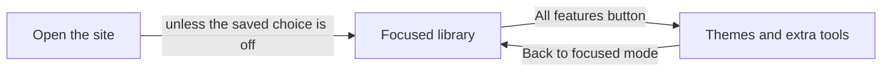
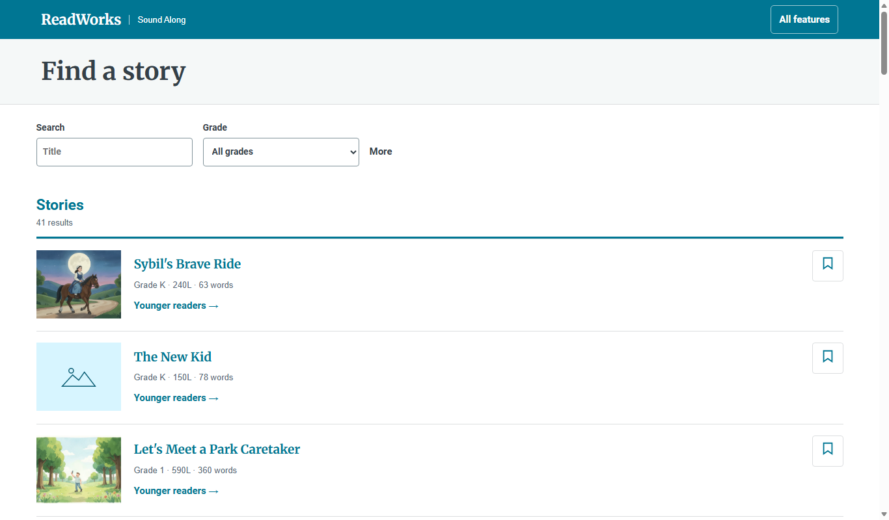

# Focused mode

*What does a reader see first, and how do they reach the other features?*

The reader · Status: built and tested locally

A reader who opens Sound Along should start reading, not choose a look. The first screen is a story library. Opening a story shows the article, its illustration, word meanings, and a player. The player holds the reading tools: speed, a choice of voice when the passage has more than one, text size, and three ways to follow the narration.

An **All features** button opens a wider set of visual designs and tools, so teammates and ReadWorks can compare them. A **Back to focused mode** button returns to the simple view. The browser remembers the choice. The switch changes only what is shown. It does not change the passage or create an account.

**Focused mode is the simple first view, and the wider design experiments are one button away.**

The diagram shows the switch between the two views.

The screenshot shows the library as a reader first sees it, with filters on the left, story rows, and the All features button.

## How it connects

Start with [Story library](story-library.md) to see the first screen, then [The passage reader](the-passage-reader.md) for a story. [All features and themes](all-features-and-themes.md) shows what the button reveals.

## Where it stands

The build team's Nov. 4, 2026 run passed 41 of 41 focused browser checks on The Big Hike and both long passages at six screen sizes, in muted Edge. The team reports focused mode is deployed on the event AWS account with generated voice (Ruth). Use on a classroom device, or by a child, teacher, or ReadWorks reviewer, isn't recorded. The ReadWorks review on record is of an earlier themed demo. The browser run was muted and did not test listening quality. The team reports the live site is public to anyone with its address and has no sign-in.

---

## Technical details

`frontend-src/src/focused.js` holds a Vue `ref`, initially true unless local storage key `rwp-focused-mode` equals `off`. `setFocused` writes `on` or `off`; storage failure leaves the choice in memory for the page. `frontend-src/src/router.js` redirects an empty hash to `#/look/mix/` when this is not the public sample and either focused mode is active or the build sets `VITE_SHOWCASE=1`. `frontend-src/src/looks/index.js` resolves that route to `MixLibrary.vue` and its passage route to `MixReader.vue`. It routes the younger-reader link through `MixReader.vue` with `kid: true` while focused mode is on.

`frontend-src/src/App.vue` shows the theme bar and return button only outside focused mode. The Mix library and reader each show **All features** while focused. The focused reader hides highlight colors, voice visualization, line masking, and the sound toggle, while retaining its core reading tools. `PUBLIC_SAMPLE` has separate routing and should not be taken as this entry flow. The default stack uses Joanna; the team reports the live stack uses Ruth with the word check on and the passage API off.

To check locally, start the frontend with `npm run dev -- --host 127.0.0.1 --port 8992` from `frontend-src`, then, from the repo root, run `node frontend-src/tests/focused_browser.mjs http://127.0.0.1:8992`. That script needs Microsoft Edge in its default Windows install folder (the path is fixed in the script) and local passage data; it mutes audio. Confirm the storage choice in a normal browser as well, since the automated check does not establish behavior across a classroom device's browser settings.

---

Previous: [After the hackathon](after-the-hackathon.md) · [Spec home](README.md) · Next: [The passage reader](the-passage-reader.md)
