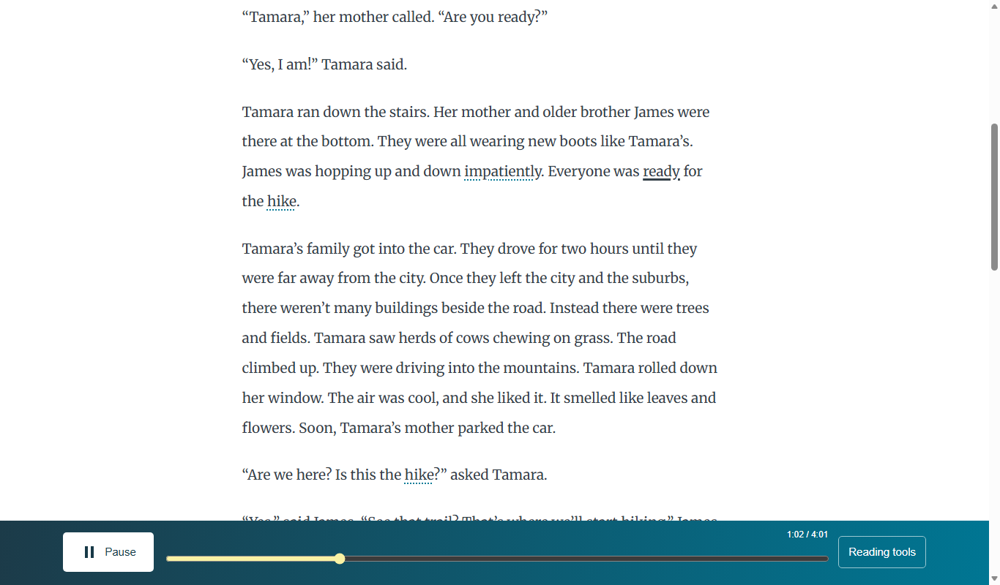

# Follow-along choices

*How can a reader choose what the narration marks?*

The reader · Status: built and tested locally

Readers differ in how much visual guidance they want. The reading tools offer three choices: highlight the current word, underline it, or tint its whole sentence while underlining the word. A reader can switch at any time. The recording and its timing stay the same, so playback does not move when the choice changes.

The word choice is the default and gives one colored marker. Underline leaves the text uncolored. The sentence choice shows more context around the spoken word. The program finds sentence edges from the passage's word order and text blocks, so they are a reading aid and not an editor's markup. The browser remembers the choice for the next passage.

**The reader can change how much visual guidance they see without changing the narration.**

The same spoken word can appear in three ways:

## How it connects

[The reader engine](the-reader-engine.md) supplies the current word, and [The passage reader](the-passage-reader.md) hosts the choices. [Screen sizes and accessibility](screen-sizes-and-accessibility.md) records what has been checked in the interface.

## Where it stands

The build team's Nov. 4 focused run passed 41 of 41 checks on The Big Hike and two long passages across six sizes, in muted Edge. That supports the visual behavior. It does not show that a child finds any cue easier to follow, or that the cues track the heard words. The team reports the reader with these choices is deployed on the event AWS account with Ruth. Its live headless check saw highlighting follow timing data, but measured no tolerance and ran muted. The choices have not been tried on a real device, and no child, teacher, or ReadWorks reviewer has tried them.

---

## Technical details

`frontend-src/src/looks/mix/MixReader.vue` initializes `follow` from `store.get('mix-follow', 'word')`. The three `aria-pressed` buttons write `mix-follow` through the app store. A watcher repaints the current word when the choice changes. The `onCurrent` callback removes old `.mix-sentence` classes and, in sentence mode, marks the range containing the engine's current word. `frontend-src/src/sentences.js` supplies `sentenceRanges` and `rangeIndexOf`; the reader passes words with their nearest paragraph, heading, or list item as block context.

`frontend-src/src/looks/mix/mix.css` gives `.sa-now` the normal highlight. In underline mode it removes that background and box shadow and adds a three-pixel underline. In sentence mode it underlines `.sa-now` while `.mix-sentence` applies the background to each word in the current range. The title and byline can receive the current-word cue; sentence painting is restricted to words in the article text.

Check the local behavior with `node frontend-src/tests/focused_browser.mjs http://127.0.0.1:8992` after starting Vite at that address. The test runs with audio muted. A real device check should include high zoom, screen reading, and a listener deciding whether sentence boundaries and visual cues match the passage as heard.

---

Previous: [The passage reader](the-passage-reader.md) · [Spec home](README.md) · Next: [Speed slider](speed-slider.md)
