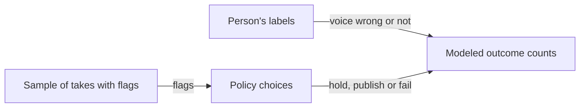
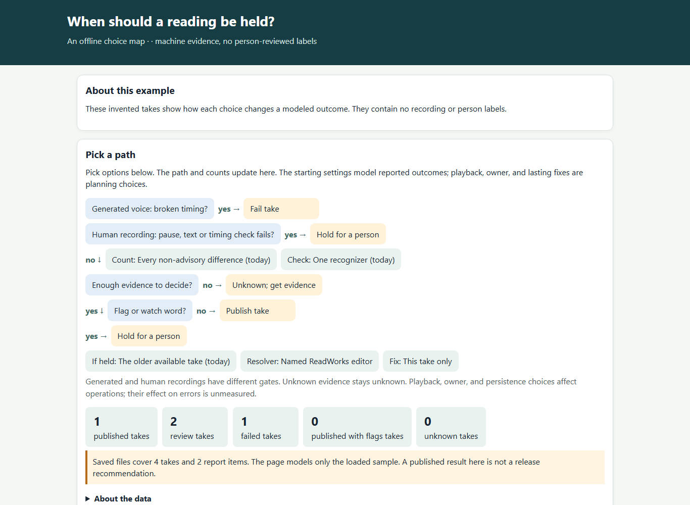

# Holds lab

*How can the team compare policies for uncertain audio without changing publication?*

Tools for people · Status: built and tested locally

When a check finds an uncertain word or an audio problem, the system can hold a recording or generated narration back from the reader. The team still has to decide how strict those rules should be. The holds lab lets people try different rules on a sample of takes and see the effect before anything is adopted.

The lab groups flagged words into recognizable kinds. A person labels each flag as a voice mistake, a recognition mistake, or something that doesn't matter. The lab then shows how many labeled mistakes a rule would block or let through. Rules can vary in which flags count, how much evidence is enough, and what happens to a hold. Where evidence is missing, the lab marks it unknown. Some failures affect a whole recording, so no word rule can clear them.

The lab's output is a suggestion for discussion, and the publishing pipeline never uses its model. The committed example is invented and has no audio.

**A simulated “published” result in the lab does not publish a take.**

The chart shows how a person's labels and the rule choices combine into counts. The screenshot shows the rule choices and the counts they produce.

## How it connects

[Held recordings](held-recordings.md) describes the real review panel where hold decisions are made. For the checks that create holds, see [Audio and pace checks](audio-and-pace-checks.md) and [Heard versus written check](heard-versus-written-check.md).

## Where it stands

The lab's policy tests ran with its public made-up sample. Its checks against historical data skip when private data is absent, so the model's effect on real ReadWorks takes could not be confirmed. The lab has not run on the event AWS account or a real device, and no person has listened to audio through it.

---

## Technical details

`tools/holds-lab/policy.py` is a pure model; `simulate.py` is its command line interface. `index.html`, `index.js`, and `label.html` provide the local pages. `serve.py` binds to loopback and serves only audio named in the loaded sample. `sample.json` contains four invented takes. Run `python tools/holds-lab/serve.py`, then open `http://127.0.0.1:8993/index.html`. Run `python tools/holds-lab/simulate.py --json` for machine-readable outcomes and `python -I tools/holds-lab/test_policy.py` for guards.

The model accepts `problem` (`all`, `meaning`, `body`), `certainty` (`one`, `second`, `homograph`), and `action` (`hold`, `publish`, `fail`), plus `play`, `owner`, and `stick` choices. These are modeled policy options, not deployed settings. Structural failures take precedence; generated takes fail and human takes remain for review. Missing second opinions or unobserved flags can produce `unknown`. Labels use stable flag IDs and are checked against the sample ID and schema before the simulator accepts an exported label file.

With permitted private data, place `private/sample.json`, run `python tools/holds-lab/build_pages.py --private`, then `python tools/holds-lab/serve.py --private --audio-1031 PATH --audio-1103 PATH`. Those files and exports are ignored by git. Tests of private historical gate flags and audio ranges skip if the data is missing. The code does not provide an independent replay of every historical result.

---

Previous: [Human recordings](human-recordings.md) · [Spec home](README.md) · Next: [Held recordings](held-recordings.md)
