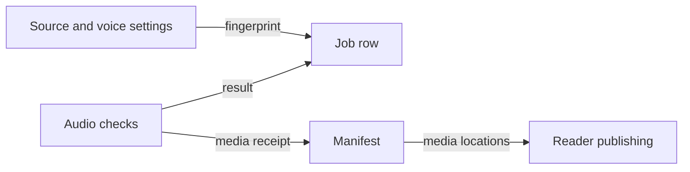

# Manifest and job record

*Where do generation results and review state live?*

The data · Status: built and tested locally

After Sound Along makes a recording, two records show what happened. The manifest is a receipt for one passage's recording: the text and voice settings used, where the audio and word-timing files are kept, and a status. The job row is the working record that changes while work runs, and notes when a result is held or fails. Both carry the passage ID and a fingerprint of the text plus voice settings, so an old recording is never mistaken for a changed passage.

A recording that generated successfully is not a recording a person approved. In the checked path the manifest says the voice was generated and needs a human check. The publishing step can still make a reader copy after the automated checks. A held result records its reasons and does not move on. The status a submitter sees (queued, running, held, failed or published) is read from these records.

**The manifest names the media; the job row tracks the work and its outcome.**

## How it connects

The fingerprint is taken from the text in [The passage file](the-passage-file.md). To see how checked media becomes a story, read [Publish to reader](publish-to-reader.md); to see how a submitter sees status, read [Send a passage API](send-a-passage-api.md).

## Where it stands

Both record writers and the status lookup are built and tested locally with stand-in services. The cloud setup builds locally, but this branch hasn't run on the event AWS account. An earlier voice test ran in a separate account and an earlier pipeline. No real-device check or person's listening review of this branch was confirmed.

---

## Technical details

`lambdas/worker/handler.py` writes `manifests/<passageId>.json` to the content bucket and a job item to DynamoDB. With the quality gate enabled, `lambdas/quality_gate/handler.py` writes the checked variant. `lib/sound-along-stack.ts` creates a job table keyed by `passageId` and `textHash`, plus a `byStatus` index. `lambdas/passage_service/handler.py` reads the manifest, job row, published content, and media objects for API status.

| Manifest field | Writer | Reader and meaning |
|---|---|---|
| `passageId`, `textHash` | Worker/hash step | Intake matches exact submission; job key uses both. |
| `audioId`, `audioProvider`, `audioType` | Worker | Names the generated audio and its source. |
| `voiceId`, `engine`, `language` | Worker | Intake checks voice; operators inspect generation settings. |
| `audioKey`, `speechMarksKey` | Worker | Reader bridge and intake locate audio and timing marks in the audio bucket. |
| `status`, `reviewStatus` | Worker or quality gate | Ungated writer sets `approved`/`unreviewed`; checked writer sets `generated`/`needs human check`. Neither value proves a person listened. |
| `qc`, `createdAt` | Ungated worker | Operators inspect automated audio checks and creation time; checked writer omits `qc` from its manifest. |

An abbreviated checked manifest shape is `{"passageId":"demo-passage-001","textHash":"sha256:<digest>","audioKey":"audio/A_Very_Small_Garden_v1_demo-passage-001.mp3","speechMarksKey":"audio/A_Very_Small_Garden_v1_demo-passage-001.speechmarks.json","status":"generated","reviewStatus":"needs human check"}`. The keys are derived by code from the demo title and ID; the digest depends on actual settings.

| Job field | Writer | Reader and meaning |
|---|---|---|
| `passageId`, `textHash` | Initial worker | DynamoDB primary key and deduplication lookup. |
| `status`, `updatedAt` | Worker, quality gate, reader bridge | API and operators see `running`, `held`, `generated`, `approved`, or `reader_publish_failed`. |
| `voiceId`, `engine`, `charCount` | Worker | Generation settings and measured normalized character count. |
| `audioKey`, `speechMarksKey` | Worker | Cached media and publication retry. |
| `reviewStatus` | Worker or quality gate | `unreviewed` (ungated) or `needs human check` (checked); also `qcWarnings` in the ungated row. |
| `reviewKey`, `holdReasons` | Quality gate | On a hold: the `review/<id>.json` object in the content bucket and the reasons. |
| `readerPublishedAt`, `readerFailureReason` | Reader bridge | Distinguishes a media result from reader publication. |

The API intake separately writes `api-jobs/<id>.json` with `id`, `text_sha256`, `pipeline_hash`, `voice`, `submitted_at`, and `words` (the list of passage words, not a count). It uses this marker for idempotency and status; it is not the DynamoDB job row. Run `python -m unittest discover -s tests -p 'test_quality_gate.py'` and `python -m unittest discover -s tests -p 'test_passage_service.py'` for local behavior.

---

Previous: [Library index](library-index.md) · [Spec home](README.md) · Next: [Website files and media](website-files-and-media.md)
