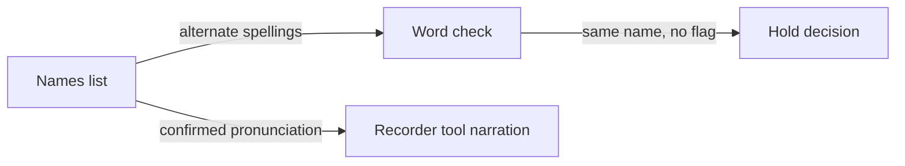

# Names and pronunciation

*Can the system tell whether a name such as Tamara is pronounced correctly?*

Tools for people · Status: design only, not built

A name can be spelled right in a passage and still be spoken in a way its owner wouldn't use. A speech recognizer can also write a different spelling for a name that was read correctly. These are two problems, and the code keeps them apart.

One list of alternate spellings tells the word check which recognizer spellings count as the same name, so they aren't flagged. A separate entry can hold a pronunciation a person has confirmed, for a synthesized voice to use. Accepting a recognizer spelling says nothing about how the name sounded to a listener.

For a name like Tamara, someone could add an entry limited to one passage, record the confirmed pronunciation, and check the narration by ear. That hasn't been done. The committed name lists are empty, and no Tamara entry or listening evidence exists. The code can't know which pronunciation ReadWorks or the named person wants. That choice belongs to ReadWorks' content team or someone they trust to confirm it.

**Tamara's pronunciation is untested, and a recognizer alias is not a pronunciation approval.**

The chart shows the two separate uses of the names list. Only a local recorder tool uses the pronunciation today; the AWS narration path doesn't load it.

## How it connects

For synthesized audio, see [Narration voice](narration-voice.md). Recognition flags are explained in [Heard versus written check](heard-versus-written-check.md), and [Volunteer recorder](volunteer-recorder.md) covers human review.

## Where it stands

The word-check tests include a made-up scoped alias and passed 12 tests, but they check only comparison behavior. No Tamara pronunciation is configured or tested, and no person has listened to a Tamara take. Nothing has run on the event AWS account or a real device. The name-list code exists; the Tamara decision and its listening check do not.

---

## Technical details

`lambdas/quality_gate/names.py` loads `config/names.json` from the content bucket, falling back to its packaged `lambdas/quality_gate/config/names.json`; a bucket file replaces the whole list. Both that file and `tools/recorder/config/names.json` currently contain `{"names":[]}`. Bad individual entries are skipped; an unusable bucket file falls back to the packaged copy. A missing or malformed packaged file yields an empty list rather than stopping a passage.

An entry can carry `written`, `heard_as`, `scope` (`*` or passage ID), `pronounce_ipa`, `status`, and `source`. `heard_as` is used by `lambdas/quality_gate/comparison.py` and recorder comparison to reconcile recognized spelling. `pronounce_ipa` is exposed by `pronounce_map`; `tools/recorder/common.py` applies it as an SSML phoneme when constructing narration text. The generated worker's default Polly path in `lambdas/worker/handler.py` was not found to load this names list or build that SSML, so end-to-end pronunciation control for the AWS narration path could not be confirmed from this code. A status beginning `confirmed by` marks the provenance claim, but the parser does not authenticate it.

Test the quality-gate behavior with `python -I tests/test_quality_gate.py`; it needs no AWS service. A real Tamara check needs the intended pronunciation from an authorized person, a produced audio take, and a listener's comparison. None is recorded here.

---

Previous: [Held recordings](held-recordings.md) · [Spec home](README.md) · Next: [Tests and how to run them](tests-and-how-to-run-them.md)
