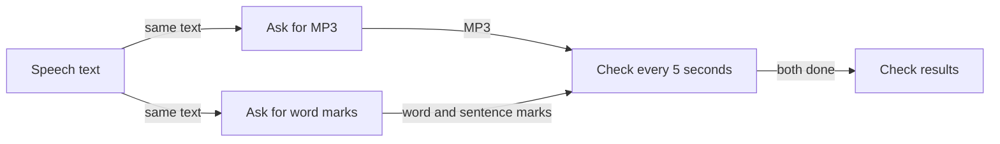

# Narration voice

*What voice reads the passage, and how is it chosen?*

Making the audio · Status: built and tested locally

A child following along needs a steady voice, and each word has to light up as it is spoken. The default setting asks Amazon's speech service to read the passage in an English voice named Joanna, using its neural (newer, more natural) engine, and to return an MP3 recording. It also returns a marker for when each word and sentence begins. The reader uses those markers to highlight words.

The voice, engine, and language are settings for a whole deployment. They are not chosen per passage. Changing them changes the fingerprint that identifies a recording, so a new voice is never mistaken for an old one. A separate setting selects a different voice, Ruth, which gets its word times another way.

In the reader, the generated voice appears beside other compatible voices, labeled with its engine and the source of its word times.

**Joanna is the default voice; whether it sounds good and highlights on time takes listening to check.**

Two requests go out for the same text, and the workflow waits for both:

## How it connects

[Generative voice setting](generative-voice-setting.md) covers the Ruth alternative. [Word timing](word-timing.md) explains what the markers become, and [Publish to reader](publish-to-reader.md) shows how the voice appears on screen.

## Where it stands

The default voice path is built and has local checks. The focused reader passed 41 of 41 muted Edge browser checks across the named passages and six screen sizes; those checks do not assess voice quality. ReadWorks heard and praised Ruth from an earlier pipeline in a separate test account. The current stack has not been seen running in the event AWS account, and no person there has confirmed its generated audio. No target-device trial with sound and a reader was confirmed.

---

## Technical details

`cdk.json` sets `soundAlong.voiceId=Joanna`, `engine=neural`, `language=en-US`; `bin/sound-along.ts` has the same fallbacks. `lib/sound-along-stack.ts` passes these to workers. `lambdas/worker/handler.py` submits two asynchronous Polly tasks with identical normalized text: MP3 and JSON speech marks (`word`, `sentence`). The state machine waits five seconds between polls and branches on completed, failed, or still running. `SubmitPollyAudio` retries all errors up to four times (five tries in all) with backoff; the workflow has a 15-minute timeout in the default configuration. `ComputeTextHash` includes voice, engine, and language.

The manifest records `audioProvider: amazon-polly`, `audioType: synthetic`, voice and engine. The reader record labels the voice `Generated voice (Joanna)` and its source `Polly neural, timed by Polly speech marks`. A different `soundAlong` context can alter the default voice and engine, but compatibility of arbitrary combinations was not confirmed. Use `npm run synth` for a local infrastructure check and `python tests/test_audio_check.py` for the audio check module; neither proves the voice is pleasant or correctly pronounced.

---

Previous: [Passage intake](passage-intake.md) · [Spec home](README.md) · Next: [Generative voice setting](generative-voice-setting.md)
