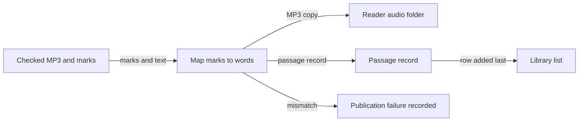

# Publish to reader

*How does checked audio become a voice in the reader?*

Making the audio · Status: built and tested locally

The reader needs more than an MP3. It needs a passage record, a voice entry, a timing row for each displayed word, and an entry in the library list. Once the audio checks pass, Sound Along builds these pieces. It checks that each word marker fits the passage, copies the MP3 to the reader's file store, writes the passage record, and updates the library list last.

That order keeps a half-finished passage out of the library on the normal path. If conversion fails, the job records a publication failure and stops. A later run can reuse the generated audio to retry. Voices already published can stay beside the new one, if the text and word mapping still fit.

The reader labels a generated voice as needing a human check, because automatic publication is not a listening approval.

**Publication means the reader has files and timing it can use. It does not mean a person has heard the narration.**

The library list is updated last, after everything else is in place:

## How it connects

[Word timing](word-timing.md) supplies the rows. [Reader passage record](reader-passage-record.md) describes what gets written, and [Library index](library-index.md) describes how readers find a passage.

## Where it stands

The bridge is on by default and has local tests. The focused reader passed 41 of 41 muted Edge browser checks across The Big Hike and both long passages at six screen sizes; the classic reader passed 162 of 162. These checks support layout and highlighting, not audible sync or AWS delivery. No current event AWS run was confirmed. ReadWorks saw an earlier themed demo before focused mode existed. No target-device trial with sound and a reader was confirmed.

---

## Technical details

`lib/sound-along-stack.ts` includes `PublishToReader` unless `-c readerBridge=false`. The worker first writes `manifests/<id>.json` and `content/<id>.json`. `lambdas/reader_bridge/handler.py` reads the source and normalized marks, verifies UTF-8 offsets, word spellings, ordering, and coverage, and writes `audio/<id>/<digest>.mp3`, `data/<id>.json`, and `data/index.json` in the private frontend bucket. The digest uses the text hash, the reader voice slot name (`generated`, or `generated-<voice>` when a different voice already holds that slot), and the MP3 ETag. The index update retries read/write confirmation six times, but it is not a transaction under concurrent writes.

The generated voice has `t` rows, `source`, `review: needs human check`, and `text_hash`. A mismatch sets job status `reader_publish_failed` and `readerFailureReason`; `IsReaderReady` reaches `ReaderPublishFailed`. Cached jobs with missing `readerPublishedAt` can enter `ReaderNeedsPublish` and retry the bridge. `scripts/publish-frontend.js` merges a live `data/index.json` into the local index, but a local `data/<id>.json` with the same ID can still overwrite a generated record; publish local media before generating. Test mapping with `python tests/test_reader_bridge.py` and an authorized deployment with `node scripts/smoke.js --stack <stack> --outputs outputs.json --yes`.

---

Previous: [Heard versus written check](heard-versus-written-check.md) · [Spec home](README.md) · Next: [Send a passage API](send-a-passage-api.md)
