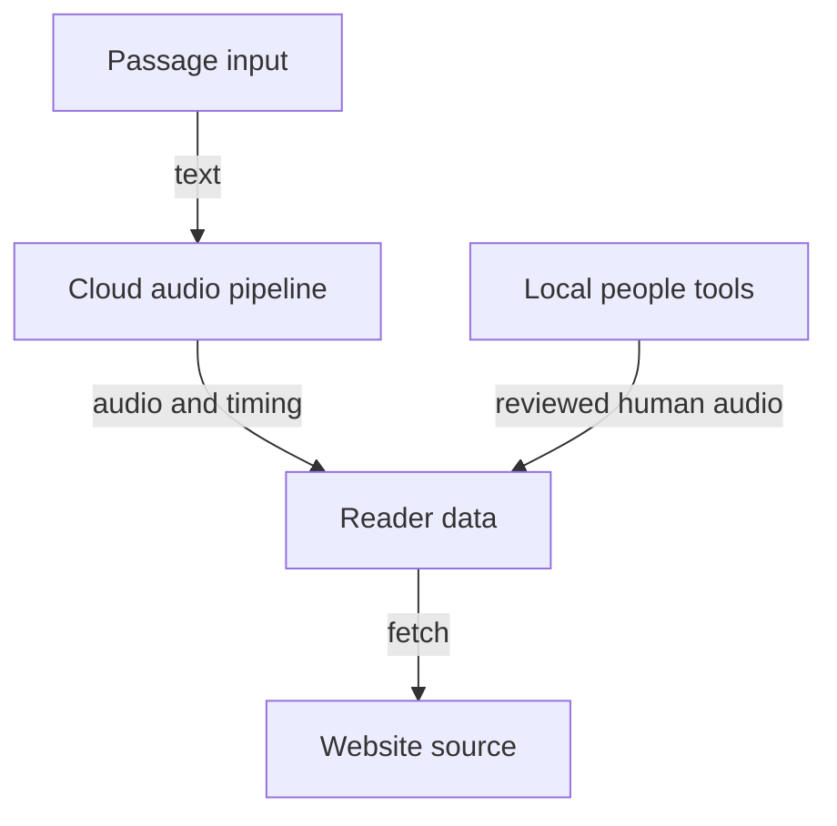

# Repo map

*Where is each part of Sound Along in this repository?*

Tools for people · Status: built and tested locally

Sound Along has two paths that meet at the reader. One prepares passage audio and word timing, checks them, and publishes passage records. The other is the website, which loads those records and follows the audio as it plays. Separate local tools let a teammate try hold rules or prepare a volunteer recording without touching the deployed system.

That gives a way to find things. For a screen, start with the website's source. For generated audio, start with the audio pipeline code. For the handoff between them, start with the passage data format.

The checked-in website is a build output, and its passage data and media are managed apart from the source. Tests sit beside both the pipeline and the screens. Some use invented data, and others expect ReadWorks media that is kept out of the repository.

**Find the part that owns the behavior first, then follow the linked data pages to its boundary.**

The chart shows the main flow, from passage text to the website, and where the local tools join it.

## How it connects

For the product view, start with [Sound Along in one picture](sound-along-in-one-picture.md). The handoffs are described in [The passage file](the-passage-file.md), [Reader passage record](reader-passage-record.md), and [Website files and media](website-files-and-media.md).

## Where it stands

Local tests cover parts of these directories, as detailed in [Tests and how to run them](tests-and-how-to-run-them.md). According to the build team's Nov. 4 run, the cloud setup builds and produces its deployment template locally. Nothing on this branch has been observed on the event AWS account. The website's muted browser checks say nothing about how audio sounds or how it works on a real device.

---

## Technical details

This map is based on commit `8516b89`. The root `package.json` builds the cloud stack; `frontend-src/` has its own `package.json` and build.

| Path | Responsibility | Start here |
|---|---|---|
| `bin/`, `lib/`, `cdk.json` | Cloud stack entry, infrastructure, and settings (root `package.json`, `tsconfig.json`) | `bin/sound-along.ts`, `lib/sound-along-stack.ts` |
| `lambdas/trigger/`, `lambdas/api/`, `lambdas/worker/` | Intake and generated audio work | `handler.py` in each directory (`worker/` also has `audio_check.py`) |
| `lambdas/quality_gate/`, `lambdas/generative_voice/` | Audio and word checks, optional generative voice path | `handler.py`, `comparison.py`, `names.py` |
| `lambdas/reader_bridge/`, `lambdas/passage_service/` | Reader records and passage service | each `handler.py` |
| `frontend-src/src/views/` | Routes and whole screens | `Library.vue`, `Passage.vue`, `Focus.vue`, `KidView.vue`, `Holds.vue` |
| `frontend-src/src/components/`, `engine/`, `soundAlong.js` | Player, word help, timing, and display components | `PlayerBar.vue`, `engine/timing.js` |
| `frontend-src/src/kid/`, `character/`, `passage/` | Kid view helpers, reading buddy characters, and word-help and rehearsal logic | `kid/pages.js`, `character/BuddyHost.js` |
| `frontend-src/src/dataKit/`, `teacherDemo/`, `looks/` | Classroom tools, invented teacher demo, and alternate looks | their component and README files |
| `frontend-src/public/` | Source site's static assets and passage data when present | `data/index.json` and passage JSON |
| `frontend/` | Built site: HTML, hashed assets, and separately managed media | `index.html`, `assets/` |
| `tools/holds-lab/`, `tools/recorder/` | Local policy exploration and volunteer recording | each `README.md` and `serve.py` |
| `tools/passage_client.py` | Signed calls to the passage API (needs `botocore`) | the file's docstring |
| `scripts/` | Build, seed, generate, publish, smoke, and timing-report commands | `build-frontend.js`, `test-frontend.js`, `timing_report.py` |
| `tests/`, `frontend-src/tests/` | Pipeline and UI checks | [Test inventory](tests-and-how-to-run-them.md) |
| `demo-data/`, `docs/` | Example passages and assignments; API and cost notes | `demo-data/passages/`, `docs/API.md`; verify claims against owning code |

`frontend-src/src/router.js` maps the hash routes. `frontend-src/src/api.js` loads either local `data/index.json` and `data/<id>.json` or a configured managed endpoint. `scripts/build-frontend.js` builds the Vue shell into `frontend/` while preserving media directories. `scripts/publish-frontend.js` uploads that static tree. The `tools/` applications are not wired into the cloud stack. See [Building the reader](building-the-reader.md) for the build sequence.

---

Previous: [Tests and how to run them](tests-and-how-to-run-them.md) · [Spec home](README.md) · Next: [Building the reader](building-the-reader.md)
