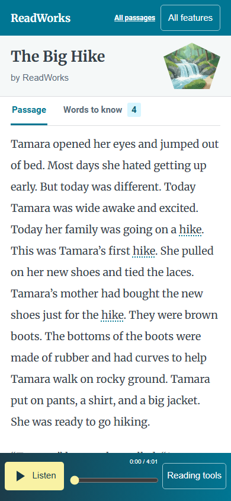

# Screen sizes and accessibility

*What has been checked about the reader across screens and input methods?*

The reader · Status: built and tested locally

A read-along must leave room for the article even when a phone has a player fixed at the bottom. On narrow screens the reader reshapes its cover, text column, word-help panel, tools, and player. On a phone, word help opens as a panel that slides up. On wider screens it sits beside the story. The library becomes compact rows with filters above them.

The site also has visible keyboard focus, labeled controls, a reduced-motion style, and a dark color scheme.

Automated layout checks can find sideways scrolling, clipped tools, and small buttons. They cannot show whether a child understands the controls, whether a screen reader reads a long article well, or whether the highlight matches the speech a person hears. A real phone and tablet still need to be tried with touch, zoom, assistive technology, and sound.

**The local browser checks cover layout and some controls, and a classroom-device accessibility test isn't recorded.**

The screenshot shows the reader at phone width with the compact player.

## How it connects

[The passage reader](the-passage-reader.md) is the screen under test. [Follow-along choices](follow-along-choices.md) covers the visual cues, and [The reader engine](the-reader-engine.md) covers keyboard movement and automatic scrolling.

## Where it stands

One known layout bug: on a phone, the library's filter panel stays pinned and covers about a third of the screen as the list scrolls. See [Story library](story-library.md). The build team's Nov. 4 focused run passed 41 of 41 browser checks on The Big Hike and both long passages at 320×568, 390×844, 844×390, 768×1024, 1366×768, and 1920×1080 in muted Edge. It checked horizontal overflow, player space, visible 44 px player targets, tool panel fit, word highlighting, and selected reader interactions. The classic reader passed 162 of 162 browser checks across its own size set. No accessibility standard has been certified or claimed. The team reports the reader is deployed on event AWS and the focused reader's image-caption overlap is fixed there. These viewport checks were local; the live headless check loaded audio and ran its clock, but did not verify keyboard operation, tap-a-word, or highlight tolerance. A classroom-device check, or use of focused mode by a child, teacher, or ReadWorks reviewer, isn't recorded.

---

## Technical details

`frontend-src/src/looks/mix/mix.css` changes the focused reader layout at 760 px and has narrower adjustments for its cover and player. `mixLibrary.css` changes library layout at 900, 760, and 420 px. The reader CSS defines `:focus-visible` outlines, dark-scheme colors, and `prefers-reduced-motion` rules. The deployed `frontend-src/src/looks/mix/mix.css` gives the focused hero caption room beside the title. `MixReader.vue` uses tab and group roles, `aria-selected` for passage tabs, `aria-pressed` for setting choices, labels for seek and speed sliders, and a dialog role for mobile word help. `SoundAlong` gives narrated word spans roving tab focus and arrow-key navigation. These code features do not by themselves prove complete keyboard or screen-reader behavior.

`frontend-src/tests/focused_browser.mjs` launches installed Edge with sound muted. Its six viewport sizes are CSS emulations, not physical devices. It checks that the page does not scroll sideways, that the dock stays below a share of the viewport, that selected visible player targets are at least 44 px high, and that tools fit on screen. The separate `reader_layout_browser.mjs` checks classic reader and kid-view layout and controls at eight sizes. Neither script is a full accessibility audit.

Run `npm run dev -- --host 127.0.0.1 --port 8992` from `frontend-src`, then `node tests/focused_browser.mjs http://127.0.0.1:8992`. On real devices, verify touch and keyboard operation, high zoom and text scaling, landscape player clearance, screen-reader reading order and announcements, color contrast in both schemes, reduced motion, and spoken-word alignment by ear.

---

Previous: [Story library](story-library.md) · [Spec home](README.md) · Next: [All features and themes](all-features-and-themes.md)
