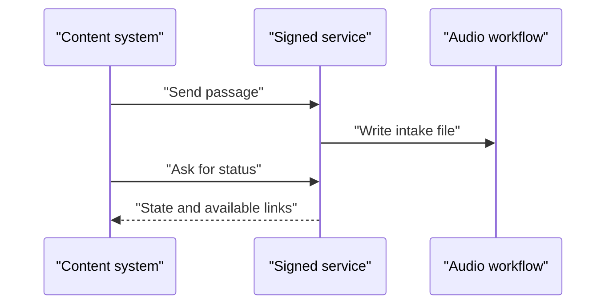

# Send a passage API

*How can another system submit a passage and check its result?*

Making the audio · Status: built, off by default

ReadWorks may want to send passages from its own content system instead of uploading files by hand. Sound Along has an optional service for that. It accepts only signed requests, which carry proof of who is asking. A caller sends a passage with an ID, title, and text, or points to an allowed source file. The service keeps only fields that are safe for the reader and writes an intake file. The ordinary upload step then starts the audio.

The caller can then ask for status. A new submission is queued, a running job is in progress, a suspected word difference can be held, and a finished one is reported as published. The reply can include short-lived links to the private MP3 and word marks. Here, published means the audio files and their records exist. It does not mean the reader's files were written, and it does not mean anyone listened.

An identical resubmission is reused. A changed passage at the same ID is rejected, and there is no option to force regeneration.

**This optional route lets another system submit a passage and check its result, using signed calls and a cleaned source record.**

One call submits, a later call asks for status:

## How it connects

[Passage intake](passage-intake.md) covers the workflow both routes share. [Heard versus written check](heard-versus-written-check.md) explains the held status, and [Manifest and job record](manifest-and-job-record.md) describes the record that status reads.

## Where it stands

The service is built, off by default, and tested locally with stand-in services. No live endpoint or event AWS run was confirmed. ReadWorks' content system has not tried it, and no person has used it with real content. No target-device trial with sound and a reader was confirmed.

---

## Technical details

`-c passageApi=true` creates `lib/passage-service.ts`: a REST API with IAM authorization on `POST /v1/passages` and `GET /v1/passages/{id}`. `-c apiSourceBucket=<bucket>` optionally permits one additional source bucket. `lambdas/passage_service/handler.py` accepts `passageId` or `uuid`, required title/text, 1–20,000 whitespace words, at most 1 MiB, an ID of 1–80 ASCII letters/digits/hyphens starting alphanumeric, and the deployed language. It retains title, text, grade band, lexile, word count, language, and supported vocabulary fields. It discards arbitrary source fields and sets `soundAlong` defaults. The protection applies to this API, not direct S3 intake.

The service writes `api-jobs/<id>.json` then `passages/<id>.json`; these are not transactional. A matching repeat returns reuse; changed content/settings, direct-upload conflict, or `force: true` returns 409. `GET` checks the job, manifest, content derivative, and audio objects. It returns `queued`, `running`, `held`, `published`, or `failed`; `audio_url` and `timing_json_url` are 15-minute signed S3 links when published, while `timing_url` stays null. The returned timing JSON is marks, not interval rows. See `docs/API.md` and `docs/openapi.yaml`; run `python tests/test_passage_service.py` locally. The existing open-CORS browser API is separate and unchanged.

---

Previous: [Publish to reader](publish-to-reader.md) · [Spec home](README.md) · Next: [AWS stack and settings](aws-stack-and-settings.md)
