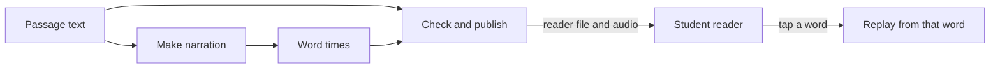

# Sound Along in one picture

*How does a ReadWorks passage become a read-along?*

The product at a glance · Status: built and tested locally

A student who loses their place in a passage cannot tell which word the voice is saying, and cannot easily replay from there. Sound Along pairs each passage with spoken narration and a time for every readable word. The browser lights each word as it is spoken, and a tap on any word replays the narration from that word.

The default screen, called focused mode, keeps the article, picture, word help, and a few reading controls together. A younger readers link shows the same article with larger text.

For a new computer voice, a cloud workflow takes the passage text and makes audio and word times. It checks the result and writes the files the site needs. An optional listening check can hold a take whose recognized words differ from the passage. Existing human recordings can be shown too, if someone supplies the prepared audio and timing; this branch has no automatic pipeline for volunteer recordings. A machine check is not a person listening.

**Each word has one number, shared by the page, its timing row, and the sound.**

In the picture, the passage text feeds both the narration and the last check, and the word times join them before the reader file is published.

## How it connects

Start with [what ReadWorks asked for](what-readworks-asked-for.md) for the need. To follow how a passage is made, read [passage intake](passage-intake.md), [word timing](word-timing.md), and [publish to reader](publish-to-reader.md) in that order. For what the student sees, go to [focused mode](focused-mode.md).

## Where it stands

The focused reader passed 41 of 41 browser checks on The Big Hike and two long passages at six screen sizes, in Edge with sound muted. The classic reader passed 162 of 162 muted checks. These runs show layout and scripted interaction, not audible synchronization. No real device or child has tried it. The AWS stack builds locally, and nothing on this branch has been seen running in the event AWS account. ReadWorks reviewed an earlier themed demo, before focused mode existed.

---

## Technical details

- `frontend-src/src/router.js` routes a fresh visit to the focused mix library. `frontend-src/src/focused.js` keeps the mode choice in browser storage; `frontend-src/src/looks/mix/MixLibrary.vue` and `MixReader.vue` render the default experience.
- `frontend-src/src/soundAlong.js` joins words in the passage HTML to a selected voice's timing rows. The same engine handles play, seek, and word activation.
- `lib/sound-along-stack.ts` composes the synthesis, validation, optional quality gate, and reader bridge. `lambdas/worker/handler.py` creates the manifest. `lambdas/reader_bridge/handler.py` writes `data/<id>.json`, audio, then `data/index.json` last. A failed word mapping stops reader publication.
- `readerBridge` is enabled unless set false. `qualityGate` and `generativeVoice` require explicit true context settings. The default voice is neural Joanna (`bin/sound-along.ts`); the optional Ruth route uses transcription for timing.
- Local checks: `npm run build`, `npm run test:frontend`, `python tests/test_reader_bridge.py`, and `node frontend-src/tests/focused_browser.mjs <site-url> [screenshot-folder]` from the repo root. The browser command needs a served site and media; the reported run used locally available ReadWorks audio that is not in the repo.

---

[Spec home](README.md) · Next: [What ReadWorks asked for](what-readworks-asked-for.md)
