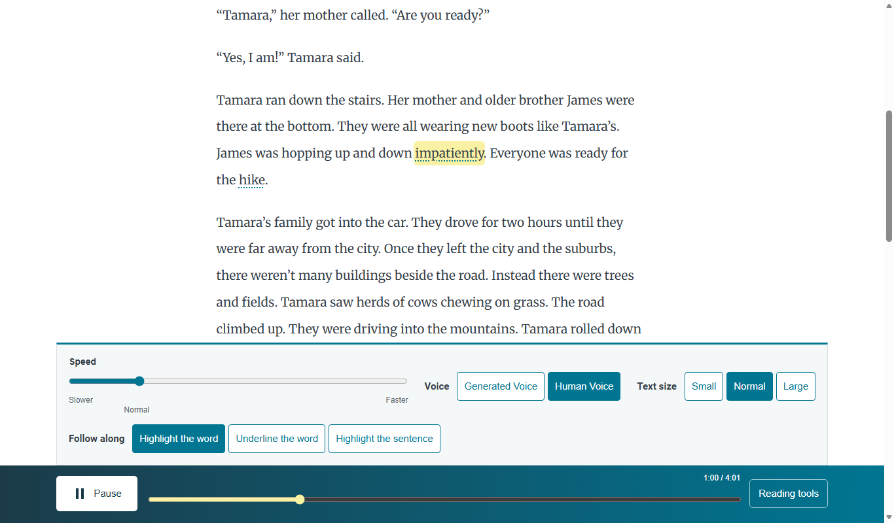

# Speed slider

*How can a reader change the narration pace?*

The reader · Status: built and tested locally

Some listeners need narration slower to catch each word, and others want it faster. The focused and classic players hold a speed slider in Reading tools. The non-focused Mix reader offers four speed buttons instead: 0.75, 1, 1.5, and 2 times. It changes how fast the same recording plays, and the story and voice stay the same.

Three labels mark the way: Slower, Normal, and Faster. The slider also stops anywhere between them. It settles gently near normal so a reader can find normal by touch. With the arrow keys, the first step away from normal is larger than later steps.

The standard passage allows a faster top speed than the younger-readers view. The chosen speed is saved in the browser. Changing speed does not regenerate the narration or alter the word timings, because the highlight follows the recording's own clock, which stays correct at any speed.

**Pace is a listener control over a recording that does not change.**

Focused and classic players use a slider; the non-focused Mix reader uses four buttons:

## How it connects

[The reader engine](the-reader-engine.md) applies the speed to the audio. [The passage reader](the-passage-reader.md) places the control in the player, and [Younger readers view](younger-readers-view.md) explains its smaller range there.

## Where it stands

The build team's Nov. 4 focused run passed 41 of 41 checks on The Big Hike and two long passages at six sizes in muted Edge. The classic reader separately passed 162 of 162. Muted checks cannot show whether slowed or sped-up speech stays clear. The team reports the focused reader is deployed on the event AWS account with Ruth. The live headless check loaded audio and ran its clock. A muted scripted run moved the slider on the live site, and a team member heard that pace change in a one-minute demo. Use of the slider on a classroom device, or by a child, teacher, or ReadWorks reviewer, isn't recorded.

---

## Technical details

`frontend-src/src/components/SpeedSlider.vue` renders a labeled native range input. Standard range is `0.75` to `2` with `0.05` steps; `kid` range is `0.75` to `1.25`. An input value from `0.9` through `1.1` snaps to `1`. Arrow keys use a `0.1` step when at normal, otherwise `0.05`, and clamp to the available range. `aria-valuetext` speaks the landmark name at the ends or normal, or the numerical multiple between them. Labels and value text have English and Spanish forms.

`frontend-src/src/looks/mix/MixReader.vue` passes the current `state.rate` to the slider and handles `change` by storing `rate` and calling `engine.setRate`. `frontend-src/src/soundAlong.js` sets both `Audio.defaultPlaybackRate` and `Audio.playbackRate`. `SpeedSlider.vue` is also used by `components/PlayerBar.vue`, `FocusRail.vue`, and `KidGrownups.vue` in the classic player. In all-features mode, MixReader shows four pace buttons (0.75, 1, 1.5 and 2 times) instead of this slider. The focused reader initializes from the stored rate; a saved value outside the younger-reader slider's range is clamped in the displayed control, so that transition deserves a device check for displayed and actual pace consistency.

Run `node frontend-src/tests/focused_browser.mjs http://127.0.0.1:8992` with the local Vite server active. Test the rate audibly on representative recordings and with keyboard and touch input on real devices before relying on it in class.

---

Previous: [Follow-along choices](follow-along-choices.md) · [Spec home](README.md) · Next: [Younger readers view](younger-readers-view.md)
