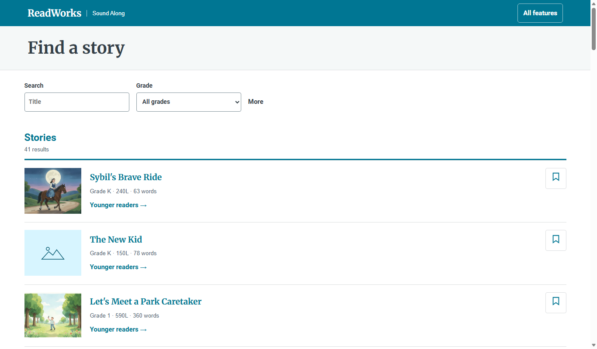

# Story library

*How does a reader find and open a passage?*

The reader · Status: built and tested locally

A reader starts by finding a story. The library lists the available passages, with filters in a sidebar on the left. A reader can search by title or narrow the list by grade. A More section adds language, the kind of voice available, and a bookmarked-only filter. A count updates as filters change, and an empty result offers a way back to all stories.

Each row shows a title, an illustration or placeholder, grade, Lexile score when supplied (ReadWorks' reading-difficulty measure), word count, and a bookmark button. English stories also get a younger-readers link. Choosing a title opens the article and its player.

Bookmarks live in this browser only. They do not assign a story to a class or sync across devices. The list comes from the site's published index of passages, so what appears depends on the data deployed with the site.

Focused mode shows plain rows. The All features view adds a bookshelf layout and a picture of where the narration pauses.

**The library takes a reader from a story title to its timed article.**

The screenshot shows the focused library at laptop size.

## How it connects

[Library index](library-index.md) defines the list data. Each row opens [The passage reader](the-passage-reader.md) or the [Younger readers view](younger-readers-view.md).

## Where it stands

On a phone, the filter panel stays pinned as the list scrolls and covers about a third of the screen. This was reproduced on the live site on Nov. 4 and isn't fixed; it needs a small style fix, then a rebuild and a redeploy. The build team's Nov. 4 focused run passed 41 of 41 checks on The Big Hike and both long passages at six sizes in muted Edge. That supports the local list and navigation, not the completeness or rights of a future ReadWorks catalog. On Nov. 4, 2026, the live library listed 14 passages: 13 labeled "Generated voice (Ruth)," seven of those also labeled "Human voice (ReadWorks recording)," and one Spanish passage with only a human voice. It listed a 1,435-word passage and a 2,046-word excerpt with Ruth as their only voice, and one passage with 46 words to know. The team reports this library is deployed on the event AWS account. Use on a classroom device, or of focused mode by a child, teacher, or ReadWorks reviewer, isn't recorded, and the ReadWorks review on record is of an earlier themed demo.

---

## Technical details

The live list is observed, while the team reports five passages were generated through the pipeline. The default stack uses Joanna; the team reports the live stack uses Ruth with the word check on and passage API off.

`frontend-src/src/looks/mix/mixLibrary.css` puts the filters in the left column of a two-column grid, and keeps them in view with `position: sticky`. Known bug: those rules come after the `max-width: 760px` rules with the same specificity, so on phones they override the two-column filter grid, and the panel stays sticky. Wrapping them in `@media (min-width: 761px)` should fix it; this is untested. `frontend-src/src/looks/mix/MixLibrary.vue` calls `loadIndex()` from `frontend-src/src/api.js`. In local mode that reads `data/index.json`; a configured published data base selects a managed index or API endpoint. The component filters client-side by case-insensitive title substring, numeric grade, `EN` or `ES`, voice ID, and bookmark membership. It sorts by grade then title. Grade options derive from the loaded items. The bookmark set persists as `mix-bookmarks`; the all-features layout persists as `mix-library-view` in the app store.

Each row links to `#/look/mix/p/<uuid>` and English entries also to `#/look/mix/kid/<uuid>`. The component loads each passage in the background, two at a time, to find its first picture's alternative text and create voice-shape maps. Focused mode suppresses those maps and forces rows even if a bookshelf preference is stored. An image failure leaves a labeled fallback. An index failure shows **Could not load the story list.**

Start Vite from `frontend-src` with `npm run dev -- --host 127.0.0.1 --port 8992` and run `node frontend-src/tests/focused_browser.mjs http://127.0.0.1:8992`. On a classroom device, check search, filters, bookmarks after reopening the browser, and whether the intended catalog and media are actually available.

---

Previous: [Younger readers view](younger-readers-view.md) · [Spec home](README.md) · Next: [Screen sizes and accessibility](screen-sizes-and-accessibility.md)
