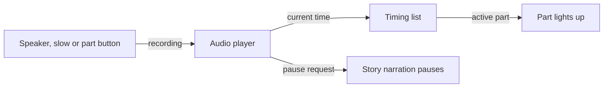

# Syllable guides and slow

*How can a reader hear a word in parts or more slowly?*

Word help and the classroom · Status: built and tested locally

Some words are easier to take one beat at a time. A syllable guide shows a word's parts in order, marks the strong beat, and lets the reader tap any part to hear it. The speaker button plays the whole word while the parts light up in time. The slow button plays a slower version, showing each part and then the whole word. A one-part word is played slowly from its whole-word recording instead.

The guide appears with word help and in vocabulary views whenever prepared guide data exists for the word. A guide belongs to one vocabulary entry, or is shared from a common word bank when the same word appears elsewhere.

The lighting follows the recording as it plays. It is a visual aid to the sound and does not make up a new pronunciation on demand. The speaker and slow buttons play older recordings in a different voice from the newer story narration. A person still needs to review pronunciation and pacing, especially for words with more than one possible pronunciation.

**The guide lets a reader hear a word piece by piece; it does not replace a listening review.**

## How it connects

[Words to know](words-to-know.md) places guides beside vocabulary entries. [Reviewing word help](reviewing-word-help.md) explains how a person checks a guide's text and recordings. [Narration voice](narration-voice.md) describes the separate story audio, which is the voice these recordings do not match.

## Where it stands

The controls are built into the local reader. The Nov. 4 focused reader run passed 41 of 41 browser checks across three passages and six screen sizes, with sound muted. A muted run cannot confirm that the recordings match the story voice or pronounce words well. No child, teacher, or ReadWorks person has listened to this version, no classroom-device trial or human listening check could be confirmed, and no run on the event AWS account has been observed.

---

## Technical details

`frontend-src/src/components/SyllableGuide.vue` expects an entry shaped like `{ word, syllables, stress_index, audio: { whole, slow, syllables }, whole_segments, slow_phases }`. `frontend-src/src/kidAudio.js` loads `data/syllables/<passage>.json`; `frontend-src/src/defs.js` may use shared word-help data if the passage has no local guide for that word. Each part is a button with an accessible label that names its place and whether it has the strong beat. The speaker and slow buttons expose their pressed state.

The component uses one `Audio` object. The whole-word mode locates the active part from `whole_segments`; slow mode reads `slow_phases`; a single-part mode lights the tapped part. `requestAnimationFrame` and `timeupdate` drive the light from `currentTime`. For a word with more than one part, the slow control plays the separate slow clip at normal rate. For a one-part word it plays the whole-word clip at `SLOW_WORD_RATE = 0.6` with pitch preserved (falling back to the slow clip if there is no whole clip). Starting a guide pauses the passage through the parent callback. `guideBus.js` lets one guide claim playback so competing guide audio stops.

`review.js` constructs a review item from the text, stress mark, and all clip paths; it verifies clip bytes before treating approval as current. Missing guide data means no guide button. A clip failure leaves the reader without that sound, so test with actual audio. The code-level check is `cd frontend-src; node tests/focused_browser.mjs <base-url>` against a running frontend (needs installed Edge); a listening check remains open.

---

Previous: [Words to know](words-to-know.md) · [Spec home](README.md) · Next: [Reviewing word help](reviewing-word-help.md)
