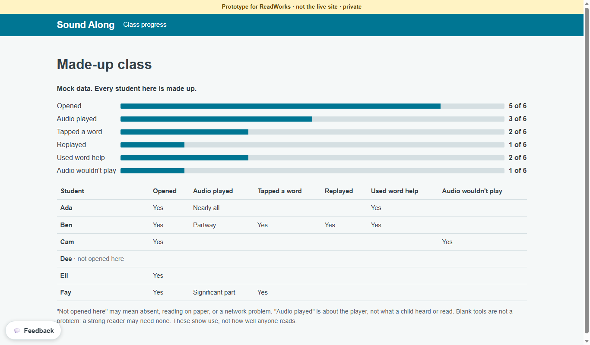

# Teacher dashboard

*What can a teacher see about one class assignment?*

Word help and the classroom · Status: built and tested locally

A teacher with a class link wants a quick answer: did students open the assigned passage, and did they use the reading tools? The class dashboard shows a class total for each permitted signal (opened, audio played, tapped a word, replayed, used word help, audio wouldn't play). Below that is a row for each name, in alphabetical order. Under a child's name the result is a yes or an audio-playback level. Finer detail appears only when pooled across the class.

A blank row invites a check-in. It can also mean the student read elsewhere, the link failed, or the name was never chosen. The dashboard says nothing about comprehension or reading ability.

The prototype includes a made-up class view and a local flow that shows reports from a class link. It does not verify who a student is: anyone with the student link can see the names and report as one of them. ReadWorks and its counsel decide whether named reporting is appropriate, who can see it, and how long it stays. Any finer class pattern should be pooled enough that it cannot point back to one child.

**A dashboard row is a prompt for a conversation, not a student score.**

The built dashboard turns coarse progress into class totals and alphabetical rows:

## How it connects

[Usage counts](usage-counts.md) defines each signal. [Class link flow](class-link-flow.md) explains how reports reach a row. [Teacher demo](teacher-demo.md) shows a richer presentation built from fixed sample data.

## Where it stands

The dashboard and a made-up class route are built. The repo's data sheet records an end-to-end local test with made-up students and a local server. The teacher demo passed 173 of 173 browser checks on one machine and 172 of 173 on another; the missed check was the standard-reader word card, and its cause is unknown. No real teacher, child, or ReadWorks person has tried this version, no classroom-device trial or human listening check could be confirmed. The team reports the reader deployed on the event AWS account, but the class dashboard was not verified there; `passageApi` is off and student access uses the legacy API only.

---

## Technical details

`frontend-src/src/dataKit/TeacherDashboard.vue` is a presentation component. Its host supplies `students: [{ name, progress }]` and `DATA_OPTIONS`; the component makes no network call. It sorts names alphabetically, shows totals as a count of students with a positive field, and renders `Yes`, a named playback level, or blank; a student who has not opened the passage is labeled `not opened here`. `frontend-src/src/dataKit/classroom/TeacherClass.vue` loads one assignment with `POST /api/class-progress`, using the teacher key from the hash URL. `#/teacher/class/demo` instead uses six made-up rows. The real route refreshes on request, without a live feed.

`frontend-src/src/dataKit/options.js` marks `opened`, `word_tap`, `replay`, `word_card_opened`, and `audio_trouble` as yes fields; `playback` is a level. The screen headings are Opened, Audio played, Tapped a word, Replayed, Used word help, and Audio wouldn't play; audio levels include Significant part. The server path is designed to return only those allowed fields. `frontend-src/src/dataKit/data_sheet.html` shows the local flow and says the server is set to expire records after 14 days. That setting needs confirmation in the actual deployment before anyone relies on it.

The broader proposal in the team's teacher design document includes assignment, student, and class-word views with question scores, richer attention rules, and support controls. The class dashboard component does not implement those views. The separate [Teacher demo](teacher-demo.md) illustrates some of them with fixed values. Run `cd frontend-src; node src/dataKit/usage.test.mjs` to check the kit, and open `#/teacher/class/demo` to inspect the display. A real device, identity check, and teacher interpretation study remain unconfirmed.

---

Previous: [Usage counts](usage-counts.md) · [Spec home](README.md) · Next: [Teacher demo](teacher-demo.md)
