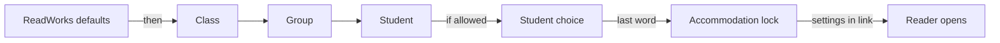
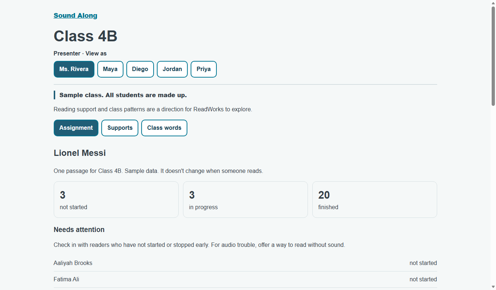

# Teacher demo

*What classroom experience does the demo actually show?*

Word help and the classroom · Status: demo with made-up data

Teachers decide on supports, such as read-aloud or high contrast, before they see them working. The teacher demo makes that concrete. A presenter can switch among a teacher view, three student views, and a content-team view. The class and assignment are invented.

The teacher view shows simple status counts, a needs-attention list, a class table, support settings, and a preview of one student's reader. It also lists words that several sample readers supposedly tapped. Student links open the real classic reader (or the big-page view) with the settings already applied. One sample student has an accommodation lock, which keeps read-aloud on even when the class setting is off. The content-team view points to word-help review and shows illustrative queue entries.

The demo does not mean the product has class rosters, sign-in, live assignments, or measured student progress. The rows and class words stay fixed while someone reads. The design document also calls for group and student controls, due dates, question scores, specialist access, and a working content console. None of these is built in the demo. ReadWorks and its counsel decide whether named reporting or these controls belong in a real classroom product.

**The demo shows how the pieces could feel together, using made-up students and fixed results.**

The diagram shows the order in which settings are applied; later steps override earlier ones.

## How it connects

[Teacher dashboard](teacher-dashboard.md) covers the separate, coarser class report. [Class link flow](class-link-flow.md) describes the prototype assignment path. [Reviewing word help](reviewing-word-help.md) covers the review screen the content-team view links to.

## Where it stands

The demo is built locally with made-up data. On Nov. 4 the build team reported 173 of 173 browser checks passing on one machine and 172 of 173 on another. The missed check was "Maya 390: standard reader shows a word card while reading." Its cause is unknown, and older local media is one possibility. No child, teacher, or ReadWorks person has tried this version, and no classroom-device trial or human listening check could be confirmed. ReadWorks saw an earlier themed demo before focused mode existed. The demo has not been observed on the event AWS account.

---

## Technical details

`frontend-src/src/teacherDemo/TeacherDemo.vue` serves `#/class-demo?as=teacher|maya|diego|jordan|priya`. `classData.js` holds one fictional assignment, 26 fictional students, three groups, fixed statuses, and four pooled class words with counts of at least three. `resolve.js` applies defaults, then class, group, student settings, permitted student choices, and finally accommodation locks. `session.js` keeps class toggles and student choices in the current browser session and encodes resolved settings in reader links. This is client-side demonstration state, not a stored assignment or server authorization.

The teacher can toggle class read-aloud, high contrast, and reader view. A table shows setting sources for the class, one group, and two students. A mini preview and “Open Maya's reader” link use the same resolved settings. The assignment tab uses fixed `opened` and `playback` values; its attention list is derived from fixed status strings. The class-word tab uses fixed entries rather than actual tap events. The content view links to the real review route but its held-take list is illustrative.

The team's teacher design document proposes editable group and individual supports, due dates, live progress and question scores, specialist permissions, a server-side settings resolver, and a unified content console. Those are ideas, not built here. Run `cd frontend-src; node tests/teacher_demo_browser.mjs <base-url>` against a running frontend (needs installed Edge) and `node tests/teacher_demo_harness.mjs` after installing frontend dependencies. In this workspace, the harness stopped before its checks because the `vue` package is absent. The build team's second-machine word-card inconsistency remains unexplained.

---

Previous: [Teacher dashboard](teacher-dashboard.md) · [Spec home](README.md) · Next: [Class link flow](class-link-flow.md)
