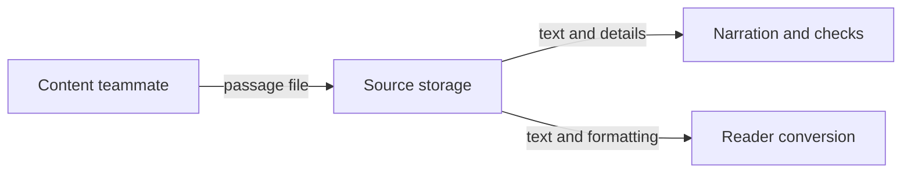

# The passage file

*What does a passage source file contain, and who uses it?*

The data · Status: built and tested locally

A passage starts as a short file from a content teammate: a title, the words to read, and optional reading help such as vocabulary. Everything else is made from it. The narration is spoken from its text, the words are counted from it, and the reader shows its words to the child, so changing one word changes all three. A stable passage ID links the file to its audio, its review and its reader copy.

The small demo passages show the simple shape. A fuller ReadWorks-style passage can also carry formatted article content and vocabulary lists. The reader copy is built only if the formatted words match the plain text. The submission service accepts fewer fields than a direct file upload does, so content staff should check the reader copy it produces, especially when the source has formatting or vocabulary.

**The source passage is the written original that narration and the reader copy are made from.**

## How it connects

To see the copy the child's reader loads, go to [Reader passage record](reader-passage-record.md). To see what the recording step produces from this source, go to [Manifest and job record](manifest-and-job-record.md).

## Where it stands

Intake and conversion are built and covered by local tests. The cloud setup builds locally, but this branch hasn't run on the event AWS account. No person was observed reading or hearing a passage it produced, and no real-device check was confirmed. Browser checks ran with sound muted.

---

## Technical details

Source examples are `demo-data/passages/demo-passage-001.json` through `003.json`. The stack reads `passages/<passageId>.json` from the content bucket. `lambdas/worker/handler.py` loads `text`, chooses `passageId` or `uuid`, normalizes whitespace, and hashes normalized text plus voice, engine, and language. `lambdas/reader_bridge/handler.py` reads the source again to build the reader copy. `lambdas/passage_service/handler.py` validates and writes the narrower API submission.

| Field | Example from `demo-passage-001.json` | Writer | Reader and effect |
|---|---|---|---|
| `passageId` | `demo-passage-001` | Content author or intake service | Worker and reader bridge use it for object keys and reader `uuid`. |
| `title` | `A Very Small Garden` | Content author | Worker names the audio; bridge displays it and makes `title_words`. |
| `text` | `The garden was small, but ...` | Content author | Narration, hash, timing, and reader HTML use these words. |
| `language` | `en-US` | Content author or intake service | Worker selects synthesis language; bridge maps English to `EN`. |
| `gradeBand`, `lexile` | `2-3`, `430` | Content author | Bridge makes reader `grade` and `lexile`. |
| `wordCount` | `52` | Content author | Kept in the source; bridge recalculates reader `wordcount` and `words`. |
| `vocabulary` | `[{"word":"color","definition":"..."}]` | Content author | Bridge makes `vocab` and links first word occurrence. |
| `questions` | Two question objects | Content author | Present in demo source; the reader bridge does not copy them. |
| `soundAlong` | `{"enabled":true,"audioAccess":"assignment"}` | Content author or intake service | Worker carries it in workflow state; this bridge does not use it to gate display. |
| `content` | Formatted HTML in the long source | Content author | Bridge wraps matching text words in numbered spans and rejects mismatches. |

The intake service accepts one to 20,000 whitespace words and a JSON body up to 1 MiB. The ID must be letters, digits and hyphens, at most 80 characters, and `index` is reserved; `language` must equal the pipeline's configured language; line breaks are kept while spacing within a line is collapsed. It preserves `title`, `text`, `gradeBand`, `lexile`, `wordCount`, `language`, and supported `vocabulary`; it sets `soundAlong` itself. Direct S3 sources need their own validation before upload. Run `python -m unittest discover -s tests -p 'test_passage_service.py'` for service behavior and the reader bridge tests under `tests/` for conversion.

---

Previous: [Cost of a passage](cost-of-a-passage.md) · [Spec home](README.md) · Next: [Reader passage record](reader-passage-record.md)
