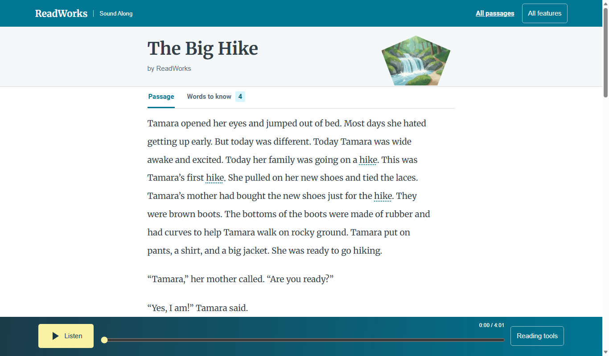

# The passage reader

*What can a reader do on the passage screen?*

The reader · Status: built and tested locally

A child reading along needs the story in front of them and the sound close by. The passage screen puts the title, byline, and illustration above the article. A player stays docked at the bottom. It plays, pauses, and moves through the recording, and it opens the reading tools without leaving the text.

As the recording plays, the spoken word lights up. Tapping a word starts the narration from there. Marked vocabulary words open a short meaning beside the story, or in a panel that slides up on a narrow screen. A second tab gathers the passage's words to know. After the article the screen shows its grade, its Lexile score (ReadWorks' reading-difficulty measure, when supplied), and its word count.

If an illustration cannot load, its description appears as text. If the recording fails, a message appears and the article stays readable. The player appears only when the passage has a recording.

**The reader joins the article and its recording at the word being spoken.**

The screenshot shows the article with the player along the bottom.

## How it connects

[The reader engine](the-reader-engine.md) explains how the highlight follows the sound. [Follow-along choices](follow-along-choices.md) and [Word meanings](word-meanings.md) cover two tools on this screen.

## Where it stands

The build team's Nov. 4 run passed 41 of 41 focused browser checks on The Big Hike and both long passages at six sizes in muted Edge. The classic reader separately passed 162 of 162. These runs checked browser behavior and layout, not whether a person heard the highlight match the voice. The team reports the reader is deployed on the event AWS account with Ruth, and passage audio loads through CloudFront. A headless browser loaded audio and ran its clock; highlight tolerance and tap-a-word were not verified. It has not been tried on a real device, and no child, teacher, or ReadWorks reviewer has tried it or heard the audio.

---

## Technical details

`frontend-src/src/looks/mix/MixReader.vue` loads a passage by route ID with `loadPassage`, transforms its stored HTML for display, and mounts `SoundAlong` only if `voices.length` is nonzero. It moves the first figure to a cover area, rewrites later figure image paths to local look art, and renders a fallback when an image fails. The lead title and byline are separate timed word spans using `data-l`; article words use `data-i`. The `Passage` and `Words to know` tabs pause narration when switched.

The dock contains play or pause, a time scrubber, and `Reading tools`. Available focused controls are a continuous speed slider, voice buttons when there is more than one voice, text size for the standard passage, and follow-along choices. The younger-reader version uses larger type and omits the size control. A playback error offers **Try again**. `MixReader.vue` loads syllables, glosses, and short word audio separately; those extras may arrive after the article. With generated voice enabled, `lambdas/reader_bridge/handler.py` also publishes new Words to know clips in the passage voice through `lambdas/syllable_audio/`: a whole word, each syllable, and a slow version in `data/syllables/<uuid>.json`. The team reports these clips play through CloudFront on the Ruth deployment. The default Joanna deployment keeps the older clips. The syllable splits and audio are marked "needs human check"; no person has judged them by ear.

Marked vocabulary uses `data-vocab-sense-id`. The focused screen limits help to those marks. Pointer hold and `?` or Shift+Enter can request help; the engine also activates a word on click, Enter, or Space. Escape closes overlays and can pause playback. The code does not establish that these interactions are understandable or comfortable to children on touch devices. The team reports tap-a-word and keyboard operation were not verified on the live build.

The syllable audio step runs after the library index write and before the final job update. A timeout could mark a live passage failed. A failed word can leave an empty guide entry, and clip paths omit the voice while caching lasts a year, so a regenerated voice may serve older clips. The team reports the live stack has the word check on and passage API off; its public legacy `/generate` route has no credential and can start paid runs. There is no human approval before generated audio can reach students.

Run the local focused check with `node frontend-src/tests/focused_browser.mjs http://127.0.0.1:8992` after starting Vite on that address. Check real audio, scrolling, and touch behavior on devices before calling the reading experience ready for use.

---

Previous: [Focused mode](focused-mode.md) · [Spec home](README.md) · Next: [Follow-along choices](follow-along-choices.md)
