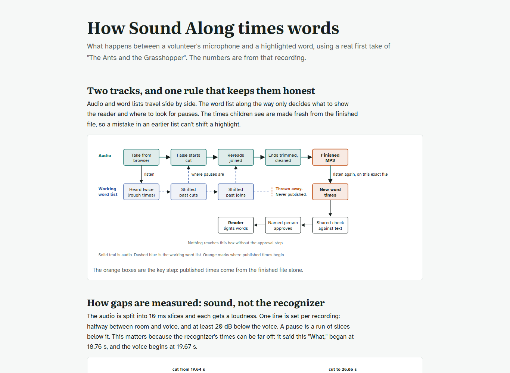

# Volunteer recorder

*How can a volunteer make a reading for a person to review?*

Tools for people · Status: built and tested locally

ReadWorks passages can be read by a synthesized voice. A volunteer can read one aloud instead, and a person checks the reading before it reaches students.

The recorder is a local tool. It shows the passage text and records the volunteer's voice. A speech recognizer listens too, and the tool compares what it hears with the written words to flag a word that looks missed or changed. The volunteer can reread a sentence or paragraph, and the tool joins the new take in at quiet points. It keeps the original take and makes a cleaned copy with word times, so the reader can highlight each word as it is spoken.

The volunteer listens, marks any flags they think are the recognizer's mistake, and sends the take to a named reviewer. Sending only creates a review item. The reviewer must listen to and approve that exact file before the reader's human voice changes. The tool has no sign-in, so the typed reviewer name is a claim, not a verified identity. The checks help find problems. They don't show that the pronunciation or the joined audio sounds right.

**A submitted recording waits for a person's listening decision before it reaches the reader.**

The screen below is the recorder's how-it-works page, which lists the steps a volunteer follows.

The local recorder moves a reading through checks and a person's listening decision:

## How it connects

To see what happens after approval, including undo, go to [Human recordings](human-recordings.md). To see how the word comparison works, read [Heard versus written check](heard-versus-written-check.md); [Names and pronunciation](names-and-pronunciation.md) explains where it struggles with names.

## Where it stands

The recorder's local tests passed 156 guard rules, using invented text and synthetic sound. The on-device speech recognizer, a real microphone, and a joined take still need a listening trial. The optional Amazon cloud listener has only a local stand-in test and is off by default. This local recorder has not run on the event AWS account or a real student device, or with a ReadWorks volunteer. The team reports that the separate generated-audio pipeline has run on the event account.

---

## Technical details

`tools/recorder/serve.py` serves the page, sessions, jobs, submission, and approval. `engine.py` handles cuts, joins, checks, and reader timing; `hear.py` uses a separate local speech environment; `voice_clean.py` cleans audio; `to_reader.py` publishes after approval. `page/` contains the volunteer and reviewer screens. `human_recordings/` and `private/` are runtime folders ignored by git.

From the repo root, run `python tools/recorder/make_demo.py`, then `python tools/recorder/serve.py`, and open `http://localhost:8975/` in Chrome or Edge. The reviewer opens `/review`. Full word checking needs `ffmpeg`, `ffprobe`, and `SOUND_ALONG_SPEECH_PYTHON` pointing to the speech environment's Python; `--speech-python PATH` is another option. The server can save a take without the checker but cannot complete its word check. A microphone needs localhost or HTTPS. Real permitted data goes under `tools/recorder/private/passages/` and `tools/recorder/private/reader/`, or through `--passages PATH --site PATH`.

The server binds to loopback. A worker queue runs one heavy speech job at a time, retries a busy GPU, and reports an unavailable checker. Approval checks reviewer name, a statement that they listened, the submitted file hash, and the gate decision. A reviewer can release word flags, but approval is refused if too little of the take matches the story or its word timing is broken. `python -I tools/recorder/tests/test_recorder_local.py` is the local regression command. It needs no AWS call, speech model, or microphone.

---

Previous: [Website files and media](website-files-and-media.md) · [Spec home](README.md) · Next: [Human recordings](human-recordings.md)
