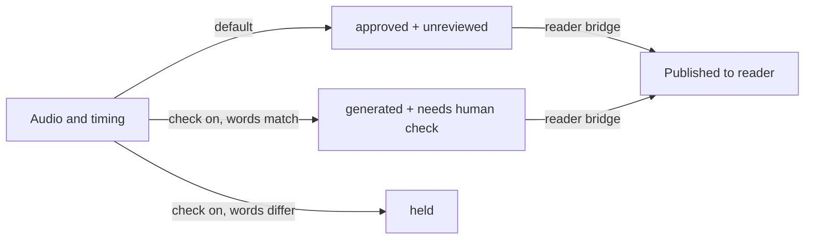

# What published, checked, and draft mean

*Does a visible passage or approval label mean a person heard and approved it?*

The product at a glance · Status: built and tested locally

ReadWorks' content staff need to know what a student can see and what a person has actually reviewed. These are different facts.

A narration is **published** when its audio and word times pass the automatic checks and its reader file is added to the library list. By default, the record for that job says "approved," but its separate review field says "unreviewed." If the optional listening check is on, a clean result is labeled "generated" and "needs human check." Neither label means a person listened.

Word help (definitions, syllable guides, and spoken clips) has its own review labels. Each item is a **draft** until a person checks that exact text and audio. **Checked** means a person approved it in one browser. **Approved** means that decision was exported, applied to the data file, and still matches the item's fingerprint (a code computed from the text and audio). Any change returns the item to draft; "needs fix" flags it for work. These labels apply to word help, not to narration.

**Published means available to students; review labels record a different kind of evidence.**

The picture shows the routes a finished take can follow. Only the first two reach students; a held take stops.

## How it connects

To see when a passage becomes available, go to [publish to reader](publish-to-reader.md). Pipeline status lives in [manifest and job record](manifest-and-job-record.md), and the separate content review is in [reviewing word help](reviewing-word-help.md).

## Where it stands

The code and local tests cover status changes and review fingerprints. No narration on this branch has been seen publishing on the event AWS account. No person is recorded as having listened to and approved this branch's generated passages or word-help clips. Browser tests ran muted, and no real device or student review is recorded.

---

## Technical details

| Label | Stored where | Exact meaning in this branch |
|---|---|---|
| `approved` plus `unreviewed` | `lambdas/worker/handler.py` manifest and job row | Default machine validation passed; the label does not record human approval. |
| `generated` plus `needs human check` | `lambdas/quality_gate/handler.py` manifest and job row | Optional transcription comparison passed; a person still needs to listen. |
| `held` | `lambdas/quality_gate/handler.py` review object and job row | Optional comparison found a difference or could not finish; this take does not reach the reader bridge. |
| Reader published | `lambdas/reader_bridge/handler.py` sets `readerPublishedAt`; `data/<id>.json`, versioned audio, and `data/index.json` exist | Reader can discover the passage. The index is written last; a bridge failure records `reader_publish_failed`. |
| `draft`, `fix`, `checked`, `approved` | `frontend-src/src/review.js` and word-help data | Draft is unchecked; fix is flagged; checked is local browser approval; approved is a data-file approval that still matches text and verified audio bytes. |

`frontend-src/src/helpPolicy.js` offers `?help=source` and `?help=reviewed` choices, but the normal `current` mode may show generated help before review. A draft marker is a warning, not a publication gate. `frontend-src/src/components/ReviewMark.vue` shows the word-help state outside presentation mode. Test the pipeline states with `python tests/test_quality_gate.py` and `python tests/test_reader_bridge.py`; test help state with `npm run test:frontend`. These are local checks with fake services or fixtures.

---

Previous: [ReadWorks' feedback and our answers](readworks-feedback-and-our-answers.md) · [Spec home](README.md) · Next: [What is proven and what is not](what-is-proven-and-what-is-not.md)
