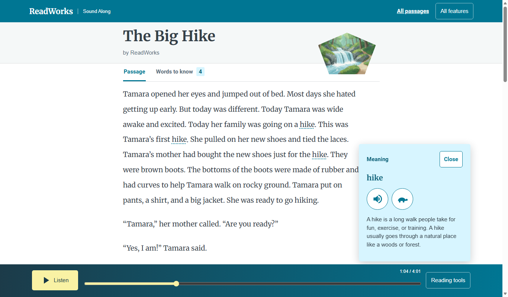
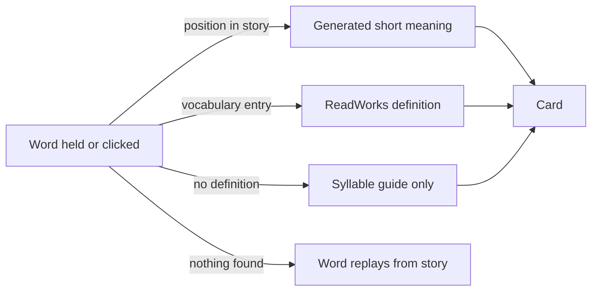

# Word meanings

*How does a reader get help with a word in the passage?*

Word help and the classroom · Status: built and tested locally

A reader who meets an unfamiliar word should not have to leave the story to learn it. Marked vocabulary words open a small card beside the text. The card shows the word, a definition, and a guide that breaks the word into parts.

In the focused reader (the default view), pressing and holding a marked word for half a second opens the card. So does pressing ? or Shift+Enter on the word. Holding an unmarked word does nothing, and the card has no spoken meaning. A click adds Spanish text where the passage has it.

The classic reader and the younger readers view work more simply. Holding any narrated word can open a short meaning and read it aloud, or replay the word from the story if no meaning exists.

ReadWorks wrote some definitions. The rest, plus the spoken definitions and syllable clips, are computer-generated. The classic and younger views mark unchecked help as draft; the focused reader shows no label. The speaker and slow buttons play older recordings in a different voice from the story narration.

**A meaning card is help in context, not evidence that the reader learned the word.**

## How it connects

[Words to know](words-to-know.md) lists all of a passage's marked words in one place. [Reviewing word help](reviewing-word-help.md) explains the draft labels. [Usage counts](usage-counts.md) explains what opening a card records.

## Where it stands

The card and the press-and-hold path are built in the local readers. On Nov. 4 the build team's focused reader run passed 41 of 41 browser checks across three passages and six screen sizes in Edge with sound muted. The classic reader passed 162 of 162 muted checks. Muted runs cannot confirm how the clips sound. No child, teacher, or ReadWorks person has tried this version, no classroom-device trial or human listening check could be confirmed, and it has not run on the event AWS account.

---

## Technical details

`frontend-src/src/passage/useWordHelp.js` owns the card, a 500 ms hold detector, the word-level prompt, and the `word_card_opened` event for the classic reader (`views/Passage.vue`) and the Reading helper (`views/Focus.vue`). The focused reader (`looks/mix/MixReader.vue`) has its own `helpFor`/`openVocab` with the same 500 ms hold, but `helpFor` returns early for any word outside a `data-vocab-sense-id` span, sets `canSay` false, never autoplays a clip, calls `findDefinition` without a `help` option, and does not import the usage counter. `frontend-src/src/defs.js` looks first for a generated gloss entry whose `indices` contain the word's `data-i`, then a ReadWorks vocabulary sense at `data-vocab-sense-id`, then a syllable guide. When none applies, the reader plays a story snippet. `frontend-src/src/components/VocabCard.vue` positions the card near its anchor, moves it on scroll, and stores optional saved words under `soundAlong.exploredWords.v1` in local storage.

`frontend-src/src/kidAudio.js` loads `data/gloss/<passage>.json`, `data/syllables/<passage>.json`, and `data/kid_audio.json`. Missing files return `null`; they do not block the passage. `frontend-src/src/helpPolicy.js` reads `?help=current|source|reviewed` from the URL (read by the classic and younger readers, not `MixReader.vue`). `current` is the default. `source` keeps original ReadWorks text where available. `reviewed` admits generated text, clips, and guides only when their corresponding review item is checked. The public sample has its own source restriction. The review state is not a global switch that silently hides every draft in `current` mode.

A marked word's short click opens its ReadWorks sense; a hold pauses narration, finds the contextual definition, and may speak it. The card's speaker uses a recorded word or definition clip, falling back to the story snippet where implemented. These clips are older media in a different voice from the passage narration. The card logs an opening without a word identifier; automatic cards do not log that event. To inspect the feature, start the frontend, then run `cd frontend-src; node tests/focused_browser.mjs <base-url>` (needs installed Edge) and open a marked word. Audio quality still needs a person listening.

---

Previous: [The reader engine](the-reader-engine.md) · [Spec home](README.md) · Next: [Words to know](words-to-know.md)
