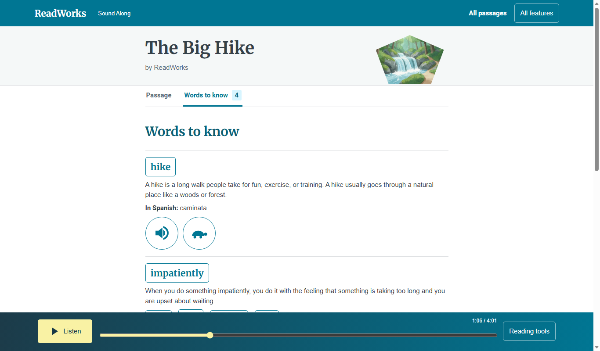

# Words to know

*Where can a reader see a passage's vocabulary in one place?*

Word help and the classroom · Status: built and tested locally

A child who wants to preview the hard words can open Words to know before or during the story, without hunting for a particular word in a paragraph. The list shows each marked vocabulary word once, even if it appears many times in the passage, with its written meaning.

The focused reader sorts the list alphabetically. Where the passage supplies them, it also shows Spanish text with a label and a guide to the word's parts. The classic Vocabulary tab adds an example sentence. The reader can hear each word, and in the younger readers view can also hear a spoken definition.

The list covers only the words ReadWorks' passage data marks, so it is not a dictionary. Generated spoken definitions and syllable guides are drafts until a person reviews them. The team reports that on the live Ruth deployment, new guide clips use the passage voice. The default Joanna deployment and shipped clips still use older recordings. If a clip is missing, the written help can still appear.

**Words to know is a passage vocabulary list, not a measure of what a child knows.**

Repeated marked words become one passage vocabulary entry:

## How it connects

[Word meanings](word-meanings.md) covers the help card that opens beside the story. [Syllable guides and slow](syllable-guides-and-slow.md) covers the audio controls. [Reviewing word help](reviewing-word-help.md) covers how drafts get checked.

## Where it stands

The focused and classic readers show the list locally. On Nov. 4 the build team reported 41 of 41 focused reader browser checks and 162 of 162 classic reader checks in Edge with sound muted. Those runs checked screen behavior, not spoken quality. No child, teacher, or ReadWorks person has tried this version, no classroom-device trial or human listening check could be confirmed. The live library lists 14 passages; 13 have a generated Ruth voice, seven of those also have a human recording, and one Spanish passage has only a human recording. A Very Small Garden lists 46 words. The team reports that Words to know played new passage-voice clips through CloudFront in a muted headless browser on the event AWS deployment. Nobody has judged the sound by ear. The team's build doc says five passages came through the pipeline; the live library alone does not identify which of the 13 Ruth-labeled passages those are.

---

## Technical details

`frontend-src/src/looks/mix/MixReader.vue` renders the focused Words to know tab from the passage vocabulary array, sorted by word, with `SyllableGuide` where a sense has guide data; the word button hears the word from the story, else its `say` clip. `frontend-src/src/views/Passage.vue` renders the classic Vocabulary tab (`views/Focus.vue`, the Reading helper, has a Vocabulary section too). `frontend-src/src/components/KidWords.vue` makes large cards for the classic younger readers view, playing word and meaning clips through its parent's clip player. `frontend-src/src/components/SyllableGuide.vue` supplies the parts, whole-word, and slow controls. `lib/sound-along-stack.ts` enables `SYLLABLE_AUDIO` only with `generativeVoice=true`, unless `-c syllableAudio=false`; the bridge receives Polly permission only then. The default Joanna deployment keeps it off. The team reports the event Ruth deployment has `generativeVoice` and `qualityGate` on, with `passageApi` off. `lambdas/syllable_audio/handler.py` makes the Ruth deployment's whole, per-part, and slow clips and writes `data/syllables/<uuid>.json`; `lambdas/reader_bridge/handler.py` calls it only when `SYLLABLE_AUDIO=true` after writing the library list. A failure records `syllableAudioError` without failing publication.

The passage record's `vocab` map is keyed by a sense ID, not by every occurrence of a spelling. A vocabulary span in the story has `data-vocab-sense-id`. Readers assemble a list from those senses; the data's written `definition`, optional `example`, optional `spanish`, and `say` word clip are separate from generated guide and spoken-definition files. `KidWords.vue` uses `?help=current|source|reviewed` through `helpPolicy.js`; the default is `current`. In reviewed mode, a generated spoken definition or guide is offered only if its review item is checked. The focused reader's list does not read `?help`.

In the classic younger-reader route, tapping a card plays the recorded word then its spoken definition when available. A whole-word syllable-guide playback can also lead into the spoken definition; tapping one syllable or slow playback stands alone. In `KidWords.vue` a card with a guide or a clip shows no written definition (the audio is the point); the written definition appears only for a word with neither. Generated guide entries are marked `needs human check`. A failed word can leave an empty guide; clip paths do not name the voice and can remain cached for a year after regeneration in another voice. A person should listen to the word and slow clips against the story voice before classroom use. To check layout locally, start the frontend, run `cd frontend-src; node tests/focused_browser.mjs <base-url>` (needs installed Edge), then open the Words to know tab.

---

Previous: [Word meanings](word-meanings.md) · [Spec home](README.md) · Next: [Hear words in parts or slowly](syllable-guides-and-slow.md)
