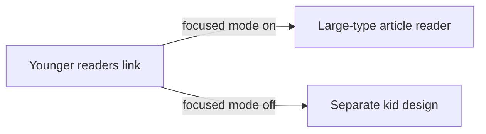
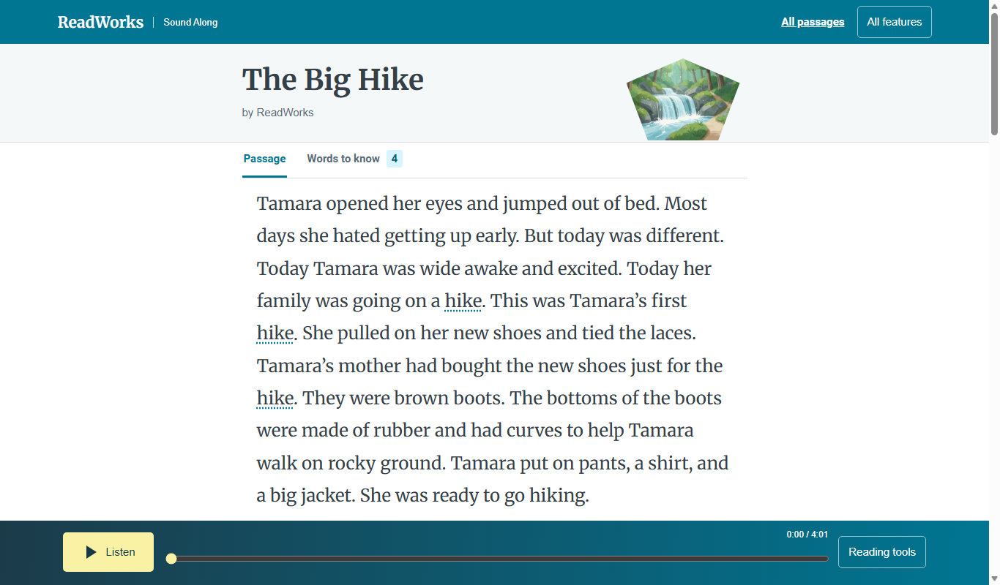

# Younger readers view

*What changes when a reader opens the younger-readers link?*

The reader · Status: built and tested locally

Younger children read better in larger type and with fewer details on screen. English stories in the library carry a **Younger readers** link. It opens the same article and narration in a calmer view with larger text. The title, illustration, words to know, and bottom player look familiar, so a child learns no new path.

The grade and credit details are hidden. The speed slider has a smaller top speed. The text-size control is absent because the view already sets a large size.

This changes how the passage looks. It is not a rewritten story or a new reading level, and ReadWorks' content staff would still need to judge whether each passage suits a particular child. The wider All features prototype has a separate kid design with its own screens. The focused link opens the article-style reader instead.

**The younger readers view changes how the passage looks, not its words or recording.**

The diagram shows that the same link leads to different screens depending on the mode. The screenshot shows the larger type.

## How it connects

The link lives in [Story library](story-library.md). [The passage reader](the-passage-reader.md) describes the shared screen, and [Speed slider](speed-slider.md) gives the pace range.

## Where it stands

The build team's Nov. 4 focused run passed 41 of 41 checks on The Big Hike and two long passages across six sizes in muted Edge. The classic reader and kid-view suite passed 162 of 162. These runs did not show that younger children can navigate or understand this view. The team reports the focused reader is deployed on the event AWS account with Ruth, but did not separately verify the younger-readers link on the live build. This view has not been tried on a real device, and no child, teacher, or ReadWorks reviewer has tried it.

---

## Technical details

`frontend-src/src/looks/mix/MixLibrary.vue` builds `#/look/mix/kid/<uuid>` for the link and does not show it for entries whose language is `ES`. `frontend-src/src/looks/index.js` resolves that route to `MixReader.vue` with `kid: true` when `focused.value` is true. When focused mode is off, the same route resolves to `MixKid.vue`, a separate design. The route is therefore sensitive to the saved mode choice.

`MixReader.vue` starts `size` as `large` with `kid: true`, hides its normal text-size group and passage metadata, and passes `kid` into `SpeedSlider.vue`. `frontend-src/src/looks/mix/mix.css` makes the kid article 24 px text on wider screens and 21 px under 760 px, with adjusted line spacing. The standard passage and younger view share passage data, word timings, vocabulary, audio, and follow-along choices.

To reproduce the focused view, start Vite in `frontend-src` with `npm run dev -- --host 127.0.0.1 --port 8992`, open `#/look/mix/`, and follow an English story's Younger readers link. Run `node frontend-src/tests/focused_browser.mjs http://127.0.0.1:8992` for the automated browser checks. On a real phone or tablet, verify touch targets, readable line lengths, the fixed player, and what happens when a stored rate came from the wider standard range.

---

Previous: [Speed slider](speed-slider.md) · [Spec home](README.md) · Next: [Story library](story-library.md)
